# 입찰 레이더 라이트

*Daily public-bid radar for small contractors.*

매일 아침, 오늘 새로 뜬 공공 입찰 공고 중 우리 회사 조건에 맞는 것만 추천 근거와 함께 알려 주는 작은 웹 앱입니다.

**라이브 데모**: <!-- DEMO_URL -->[https://bid-radar-lite-1072416881206.asia-northeast3.run.app](https://bid-radar-lite-1072416881206.asia-northeast3.run.app) (가입 없이 "데모로 둘러보기")

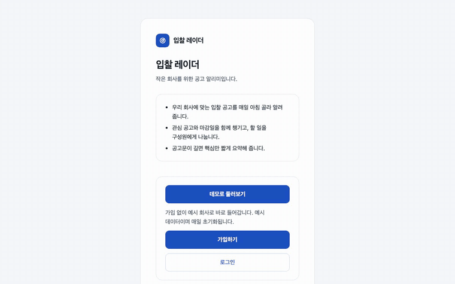

<table>
  <tr>
    <td width="75%">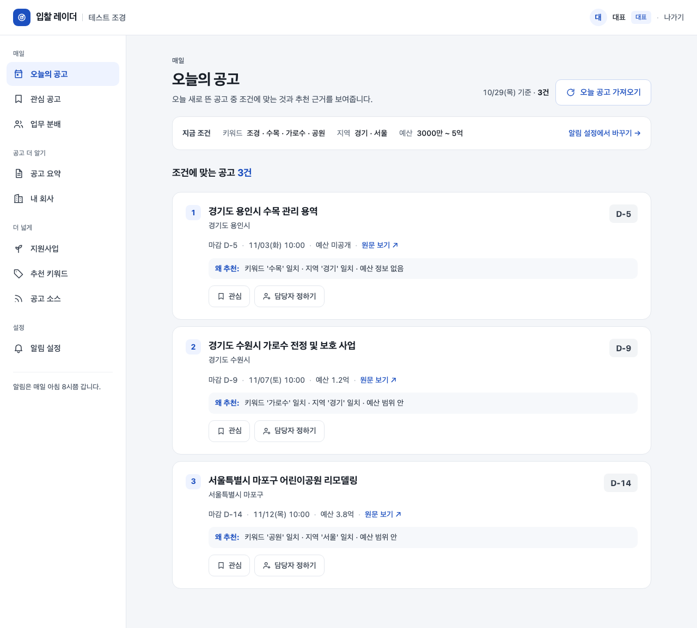</td>
    <td width="25%">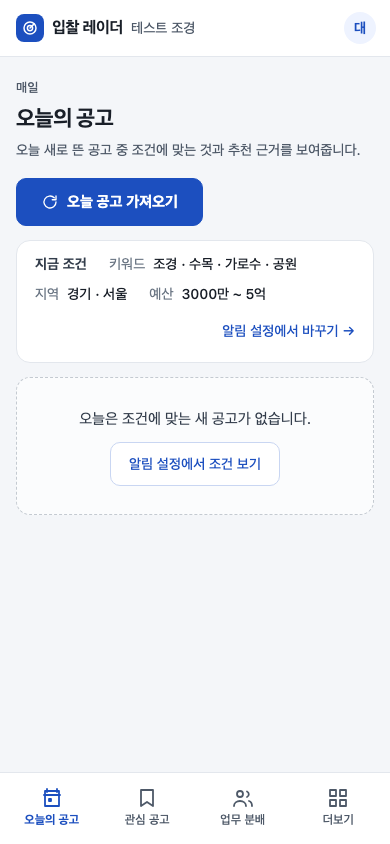</td>
  </tr>
  <tr>
    <td align="center">오늘의 공고 (데스크톱)</td>
    <td align="center">모바일</td>
  </tr>
</table>

## 왜 만들었나

작은 회사에는 입찰 담당자가 없습니다. 나라장터·지자체·공공기관 공고는 흩어져 있고 마감은 짧아서, 매일 확인할 여력이 없는 업체는 기회를 놓칩니다. 기존 유료 서비스는 큰 업체 기준이라 비싸고 복잡합니다.

그래서 업종 키워드·지역·예산 범위만 적으면, 아침마다 맞는 공고 몇 건을 "왜 추천했는지"와 함께 보내 주는 도구를 만들었습니다.

**하지 않는 것**: 입찰서·제안서 작성 대행, 낙찰 예측.

## 주요 기능

앱은 두 가지 방식으로 실행할 수 있습니다.

- **기존 모드 (회사 하나)**: 한 설치를 한 회사가 씁니다. 가입 없이 초대 링크로 들어옵니다. `SUPABASE_URL` 이 비어 있으면 이 모드입니다.
- **가입 모드 (여러 회사)**: 공개 주소에서 누구나 이메일·비밀번호로 가입하고(메일 인증), 자기 회사를 만들어 구성원을 초대합니다. 회사마다 공고·설정·인증키가 완전히 분리되어 다른 회사의 것은 보이지 않습니다. `SUPABASE_URL` 등을 적으면 켜집니다.

왼쪽 메뉴는 네 묶음, 10개 메뉴입니다 (가입 모드는 **연결 설정** 을 더해 11개). 처음 쓰는 사람은 **오늘의 공고** 한 화면만 보면 됩니다.

| 묶음 | 메뉴 | 하는 일 |
|---|---|---|
| 매일 | 오늘의 공고 | 오늘 새로 뜬 공고 중 조건에 맞는 것과 추천 근거(`왜 추천: …`)를 보여 줍니다. 카드마다 마감 시각·개찰 일시·예산 기준과 변경·취소·재공고 표시가 붙습니다. 사전규격 → 본공고 연결 표시(`사전규격 있었음 · 의견마감 …` / `본공고 나옴 → …`)도 함께 보입니다. |
| 매일 | 관심 공고 | 관심 표시한 공고의 마감 D-day 와 입찰 전 확인 항목을 관리합니다. |
| 매일 | 업무 분배 | 공고를 담당자에게 넘기고 검토중 · 참여 · 패스 상태를 함께 봅니다. 구성원 초대도 여기서 합니다. |
| 공고 더 알기 | 공고 요약 | 공고문을 읽어 무슨 사업인지, 필요한 자격, 제출 서류를 세 줄로 정리하고 원문 근거를 붙입니다. |
| 공고 더 알기 | 내 회사 | 회사 정보(면허·지역·중소기업 여부)를 한 번 적어 두면 공고마다 참가 가능 여부를 근거와 함께 판정합니다. |
| 공고 더 알기 | 지난 개찰 | 수요기관이나 공고명으로 지난 개찰 결과와 낙찰자를 찾아봅니다. 낙찰이 확정된 업체는 `낙찰자`, 아니면 `개찰 1순위` 로 구분해 보여 줍니다. 공개된 결과만 보여 주고 낙찰 가능성은 계산하지 않습니다. |
| 더 넓게 | 지원사업 | 정부·지자체 지원사업과 바우처 공고를 입찰과 따로 모아 보여 줍니다. |
| 더 넓게 | 추천 키워드 | 지금 키워드와 비슷한 말을 제안하고, 채택한 말로 관련 가능성 있는 공고를 하루 1건까지 더 찾습니다. |
| 더 넓게 | 공고 소스 | 나라장터 공사 공고와 사전규격(기본 켬) 외에 지자체·기관 게시판(RSS·Atom)을 붙이고 가져온 결과를 확인합니다. |
| 설정 | 알림 설정 | 업종 키워드 · 제외 키워드 · 지역 · 예산과 알림 받을 곳을 정하고 오늘 것을 미리 봅니다. |
| 설정 | 연결 설정 (가입 모드) | 나라장터·자동 요약·지원사업 인증키를 회사가 직접 등록하고 `연결 확인` 으로 실제로 되는지 봅니다. 저장·삭제는 대표만 합니다. |

가입 모드에는 메뉴 밖에 첫 화면(소개), 가입, 로그인, 비밀번호 재설정, 내 계정(비밀번호 변경·계정 삭제), 회사 만들기·전환, 초대 수락 화면이 더 있습니다. 메뉴 밖 공개 화면으로 서비스 현황(`/status`)과 운영자 전용 운영 현황(`/admin`)도 있습니다.

<details>
<summary>메뉴별 화면 보기</summary>

<table>
  <tr>
    <td>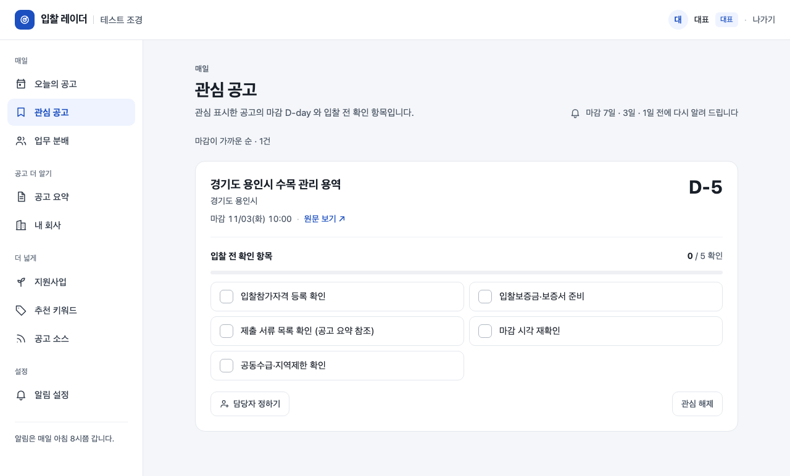<br><sub>관심 공고</sub></td>
    <td>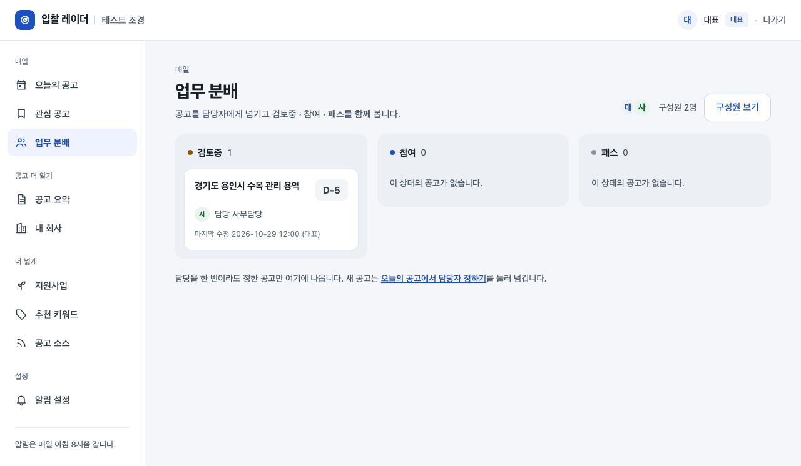<br><sub>업무 분배</sub></td>
    <td>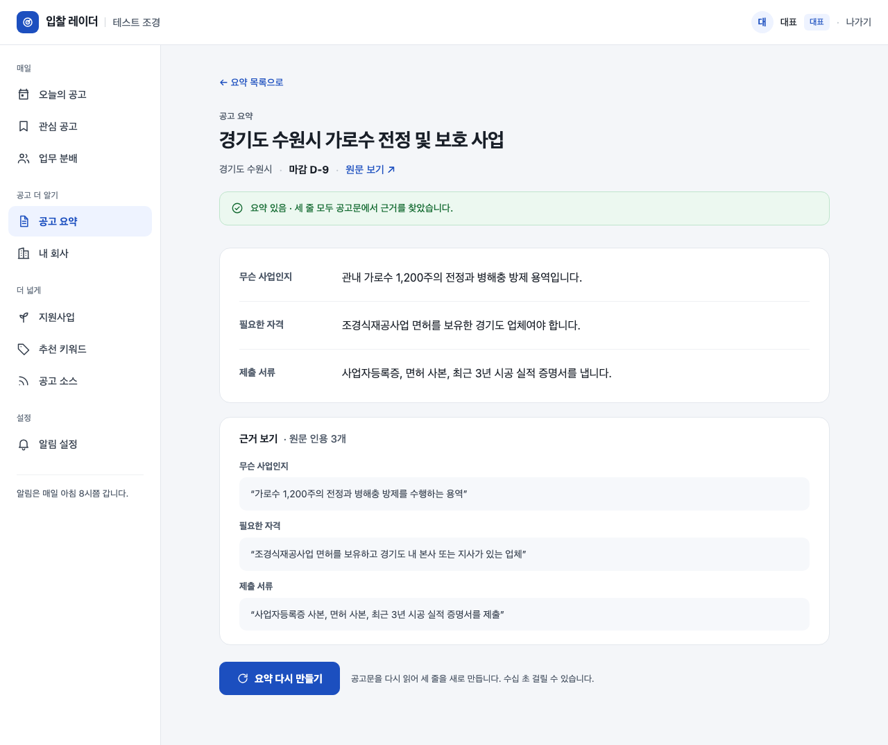<br><sub>공고 요약</sub></td>
  </tr>
  <tr>
    <td>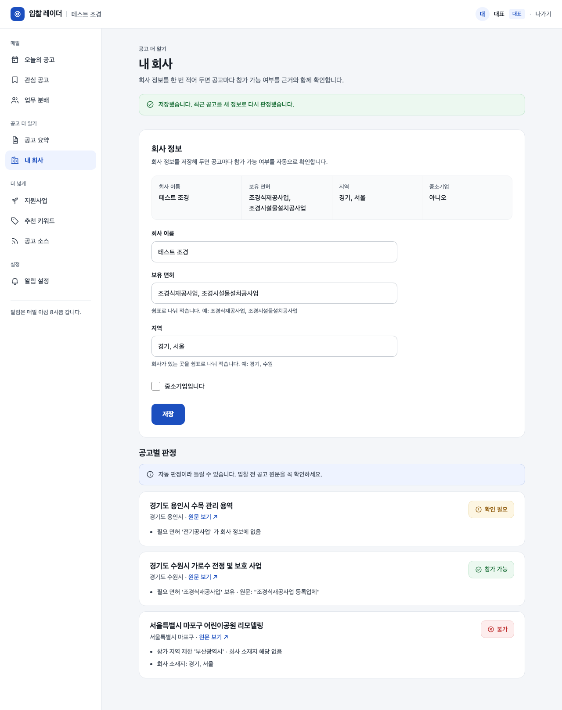<br><sub>내 회사</sub></td>
    <td>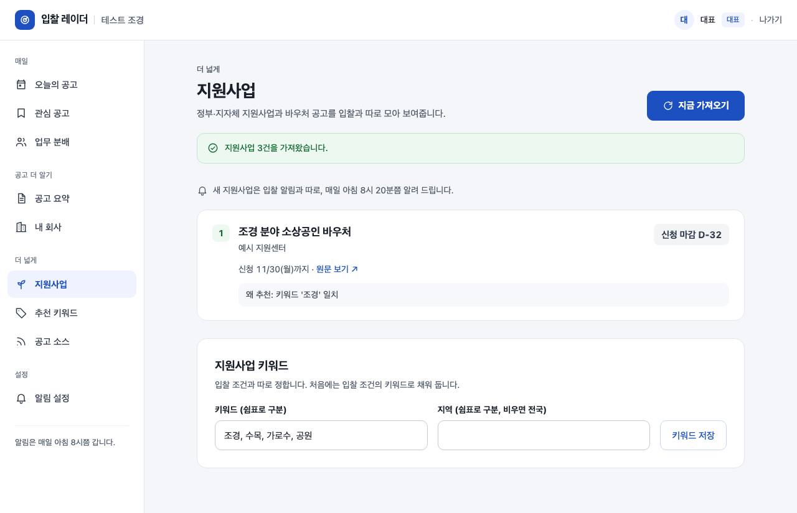<br><sub>지원사업</sub></td>
    <td>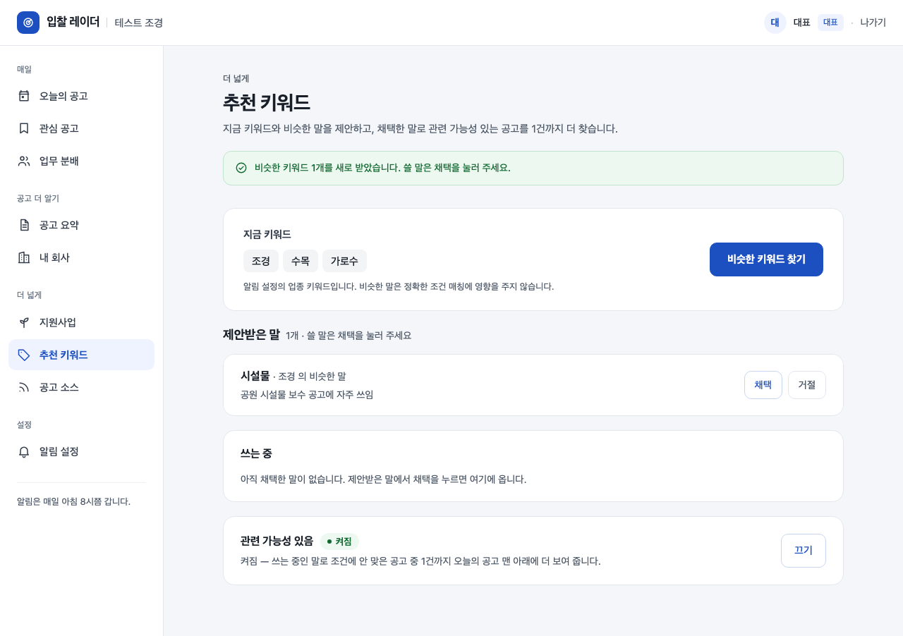<br><sub>추천 키워드</sub></td>
  </tr>
  <tr>
    <td>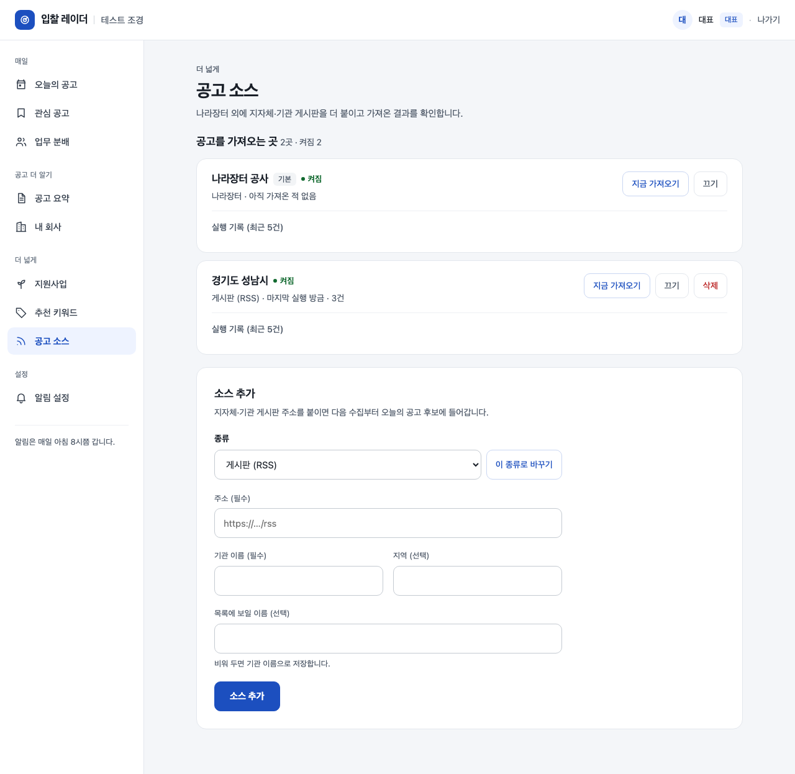<br><sub>공고 소스</sub></td>
    <td>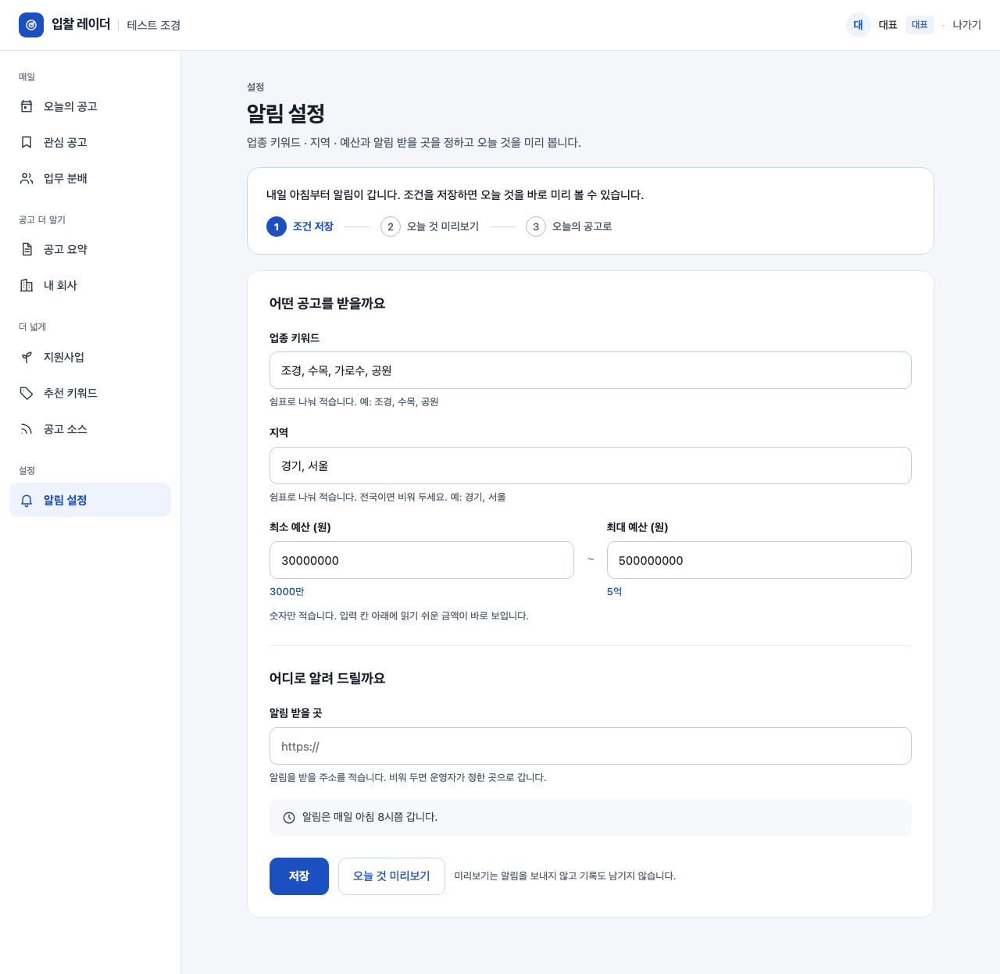<br><sub>알림 설정</sub></td>
    <td><br><sub>오늘의 공고</sub></td>
  </tr>
</table>

</details>

<details>
<summary>가입 모드 화면 보기</summary>

<table>
  <tr>
    <td>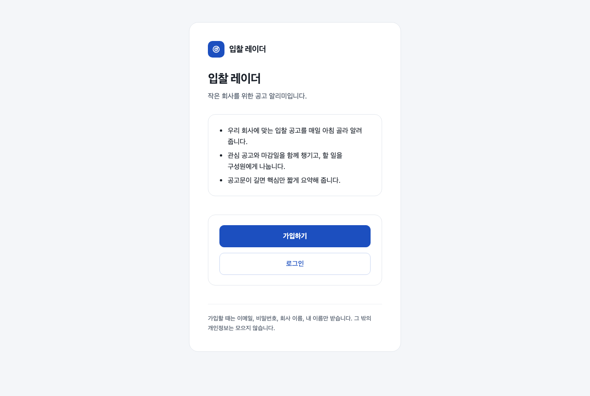<br><sub>첫 화면 — 가입하기 · 로그인</sub></td>
    <td>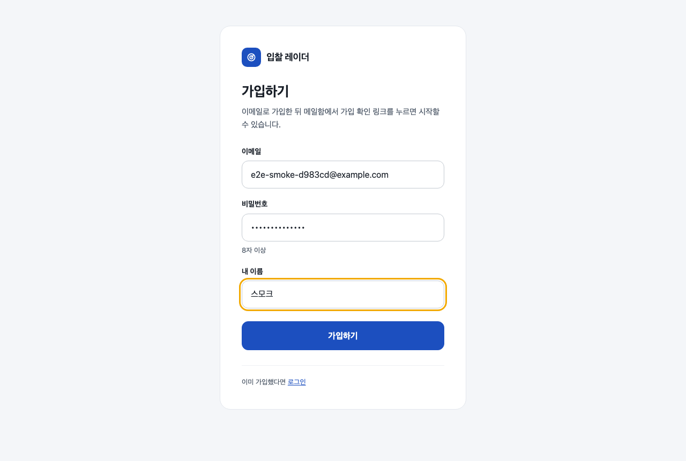<br><sub>가입하기 — 이메일 · 비밀번호(8자 이상) · 내 이름</sub></td>
  </tr>
  <tr>
    <td>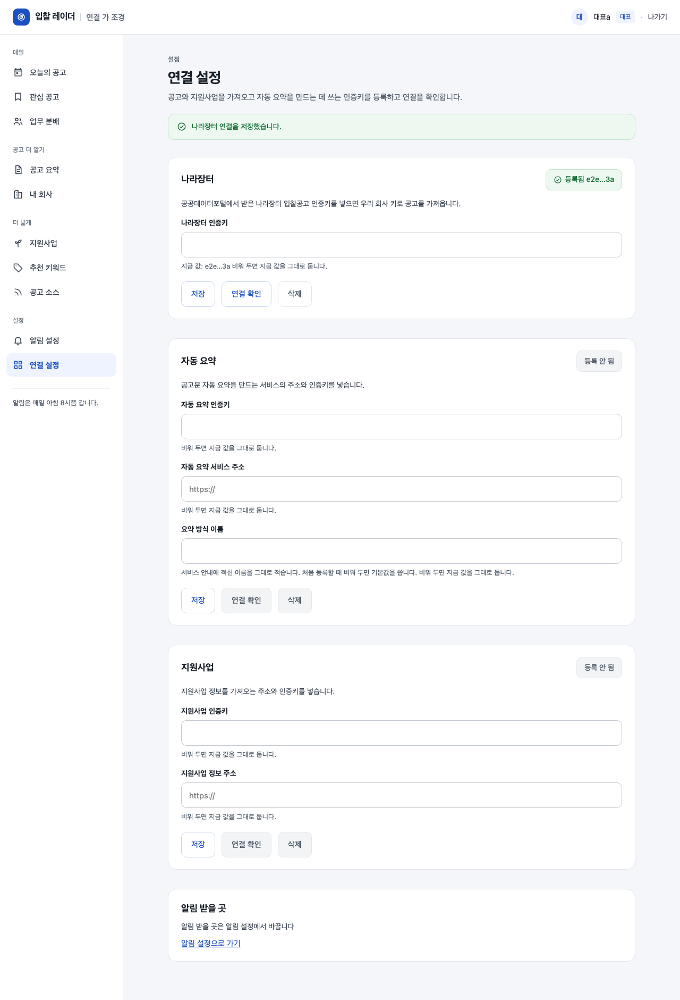<br><sub>연결 설정 — 등록된 인증키는 일부만 보임</sub></td>
    <td>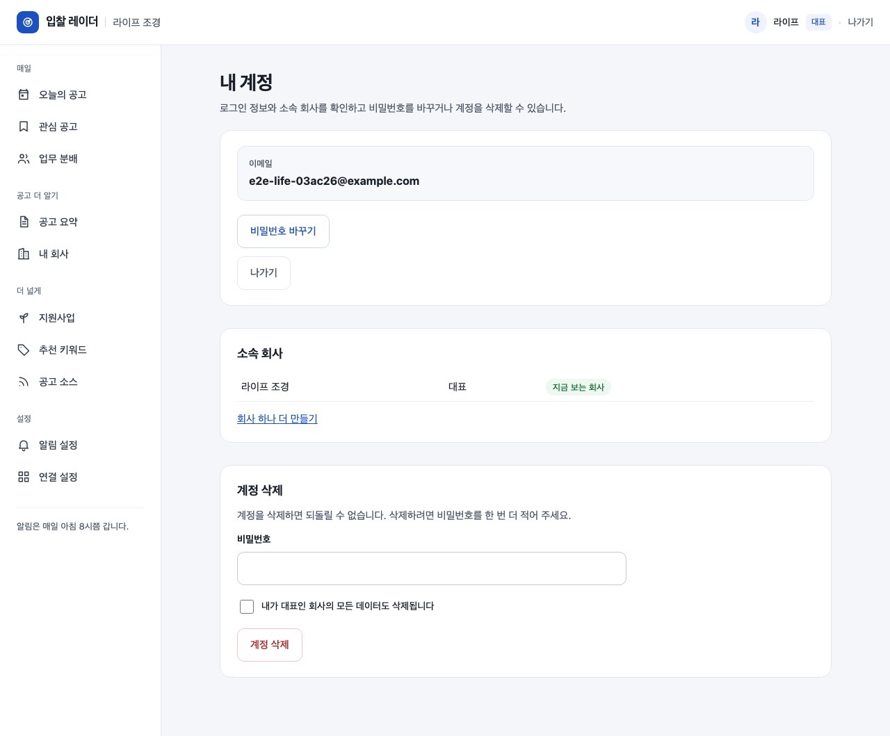<br><sub>내 계정 — 비밀번호 바꾸기 · 소속 회사 · 계정 삭제</sub></td>
  </tr>
</table>

</details>

## 라이브 데모

첫 화면의 **데모로 둘러보기** 를 한 번 누르면 가입·메일 확인 없이 예시 회사 `새봄조경(예시)` 로 들어가 오늘의 공고 화면이 열립니다. 공고 14건(오늘 추천 7건), 관심 공고 4건, 업무 분배 5건, 낙찰 이력 7건, 공고 요약 2건, 구성원 3명(예시 대표·예시 구성원 가·예시 구성원 나)이 미리 채워져 있어 모든 메뉴를 바로 둘러볼 수 있습니다.

- **예시 데이터 표시**: 화면 위에 노란 배너(`예시 데이터로 둘러보는 중입니다 · 매일 첫 방문 때 초기화 · …`, 예약 실행을 켠 환경에서는 초기화 시각을 표시)와 `내 회사로 시작하기` 링크가 붙고, 오늘의 공고·관심 공고·업무 분배·낙찰 이력 카드에 `예시 데이터` 칩이 붙습니다. 데이터 자체도 공고 번호 `DEMO-001` 형식, 출처 `demo`, 기관명 `(예시)` 접미, 링크 `https://example.com/demo/…` 로 실제 공고와 섞이지 않습니다.
- **매일 초기화**: `GET /api/jobs/demo-reset`(헤더 `x-job-token`)이 예시 회사를 처음 만들고, 이후 부를 때마다 그 회사의 업무 데이터를 모두 지우고 처음 상태로 다시 채웁니다. 운영(`APP_SCHEDULER_OFF=1`)에서는 한국 시간으로 날짜가 바뀐 뒤 첫 `데모로 둘러보기` 로그인이 앱 자신의 이 주소를 불러 초기화하고, 끝날 때까지 최대 `APP_DAY_START_RESET_WAIT_MS`(기본 20초) 기다립니다. 매일 첫 방문 때 초기화되는 셈입니다. 데모에서 바꾼 내용은 다음 초기화 때 사라집니다.
- **막아 둔 동작**: 인증키 저장·삭제·연결 확인, 비밀번호 변경·계정 삭제, 회사 만들기, 구성원 초대, 공고 가져오기, 공고 소스 추가·변경, 자동 요약·추천 키워드·자격 판정 실행(데모 회사에서는 외부 LLM 을 부르지 않음), 요금제 변경·해지·재개, 알림 설정의 수신 이메일·웹훅 주소 변경(키워드·지역·예산 같은 조건은 바꿀 수 있음). 누르면 `예시 회사에서는 이 동작을 막아 두었습니다. 내 회사를 만들면 쓸 수 있습니다.` 안내가 나옵니다(403). 결제 카드 등록은 토스 테스트 키(`test_ck_…`)일 때만 열려 실제 결제가 일어나지 않습니다. 예시 회사에는 매일 알림(웹훅·이메일)을 보내지 않습니다.
- **데모 계정**: 계정 3개는 `APP_DEMO_EMAIL_DOMAIN`(기본 `demo.example.com`) 주소로 Supabase Auth 에 만들어지고, 비밀번호는 `APP_SECRET` 에서 파생해 메모리에서만 씁니다(화면·로그에 나가지 않음). 내 계정 화면은 `예시 계정은 바꾸거나 지울 수 없습니다` 로 잠겨 있습니다.
- **켜고 끄기**: 가입 모드에서 `APP_DEMO=1` 일 때만 버튼과 데모 주소가 생깁니다. 비어 있으면 둘 다 404 입니다. 데모 로그인은 IP 마다 15분에 20번, 하루 전체 `APP_DAILY_MAX_DEMO_LOGIN`(기본 500)번까지이고, 넘으면 `오늘은 데모 이용이 많아 잠시 닫혀 있습니다. 내일 다시 열립니다.` 가 나옵니다.

로컬에서 데모를 띄우려면 가입 모드 설정(아래 [가입 모드 (로컬 Supabase)](#가입-모드-로컬-supabase))에 `APP_DEMO=1` 을 더해 앱을 켜고, 예시 회사를 한 번 만듭니다.

```sh
curl -sf -H "x-job-token: $APP_JOB_TOKEN" http://localhost:8820/api/jobs/demo-reset
# {"ok":true,"workspaceId":"…","bids":14,"resetCount":1}
```

README 의 데모 GIF(`assets/demo.gif`)는 데모가 켜진 앱을 브라우저로 한 바퀴 돌며 녹화해 만듭니다. 동선은 첫 화면 → 데모로 둘러보기 → 오늘의 공고(첫 카드 `왜 추천됐나` 펼침) → 관심 공고 → 업무 분배 → 요금제 → 서비스 현황입니다.

```sh
node scripts/record-demo.mjs --base-url http://localhost:8820            # → assets/demo.gif (30초, 960px, 10fps)
node scripts/record-demo.mjs --base-url http://localhost:8820 --seconds 25 --out assets/demo.gif
```

Playwright 로 1200×750 화면을 녹화한 뒤 ffmpeg 로 팔레트 GIF 를 만듭니다. ffmpeg 가 없으면 녹화본을 `assets/demo.webm` 으로 남기고 변환 명령을 출력한 뒤 종료 코드 2 로 끝납니다.

## 새로 더한 화면

### 왜 추천됐나

오늘의 공고 카드마다 접힌 줄 `왜 추천됐나 · 3/4 조건 맞음` 이 붙습니다. 펼치면 조건 4개를 하나씩 `맞음` · `안 맞음` · `정보 없음` 으로 보여 줍니다.

| 조건 | 맞음 | 안 맞음 | 정보 없음 |
|---|---|---|---|
| 키워드 | `키워드 '조경' 일치` (추천 키워드에서 채택한 비슷한 말 포함) | `키워드 없음 (조경·수목·공원)` | - |
| 제외어 | `제외어 없음` | `제외어 '철거' 포함` | - |
| 지역 | `지역 '경기' 일치` · 지역을 비우면 `지역 제한 없음` | `지역 '부산' 제외` | `지역 정보 없음` |
| 예산 | `예산 범위 안 (1.2억)` | `예산 범위 밖 (7.5억)` | `예산 정보 없음` |

설명은 `app/core/explain.mjs` 의 순수 함수가 카드를 그릴 때 계산합니다. 추천 자체를 정하는 `src/match.js` 는 바꾸지 않았으므로, 관련 가능성 있는 공고처럼 일부 조건만 맞는 카드에서 무엇이 빠졌는지 보입니다. 기존 모드와 가입 모드 모두 같습니다.

### 오늘 보낼 메일 미리보기

알림 설정 화면의 **오늘 보낼 메일 미리보기** 링크(`/settings/mail-preview`)는 오늘 나갈 알림 3종(오늘의 공고·마감 알림·지원사업)을 실제 메일 모양 그대로 보여 줍니다. 잡을 미리보기(`dry`)로 돌리기 때문에 메일을 보내지 않고 발송 기록도 남기지 않습니다. 받는 사람은 알림 설정의 수신 이메일이고, 비어 있으면 `받는 사람이 없습니다`, 보낼 것이 없는 종류는 `보낼 내용 없음` 으로 표시합니다. 메일 본문은 스크립트를 막은 `iframe` 안에 그립니다.

### 서비스 현황(/status)·운영 현황(/admin)

- **서비스 현황** `/status`(화면)·`/status.json`(JSON): 로그인 없이 누구나 봅니다. 오늘 수집한 공고 수, 마지막 수집 시각, 오늘 보낸 알림 수, `정상`/`점검 중` 을 보여 줍니다. 수치는 예시 회사를 뺀 실제 회사만으로 세고, 실제 회사의 오늘 수집이 아직 없으면 예시 회사 수치를 `예시 수치` 표시와 함께 보여 줍니다. 결과는 60초 동안 재사용하고 회사 id·이메일은 내보내지 않습니다. 기존 모드에도 있습니다. 예약 실행 없음(`APP_SCHEDULER_OFF=1`)일 때는 `오늘 수집`(`첫 방문 때 시작`·`진행 중`·`완료`) 줄이 더 붙고, `/status.json` 에는 `collect: { trigger, state }` 가 들어갑니다(`trigger` 는 `first-visit`/`scheduled`, `state` 는 `pending`·`running`·`done`·`off`).
- **운영 현황** `/admin`(화면)·`/admin.json`(JSON): 가입 모드 전용, `APP_PLATFORM_ADMIN_EMAILS` 에 적힌 이메일로 로그인한 사람만 열립니다(그 밖의 로그인 사용자는 404, 로그인 전이면 첫 화면으로). 타일 7개 — 회사 수(예시 회사 포함 수), 구독 상태별 수, 월 반복 매출(이용 중인 요금제 합계), 최근 30일 결제 실패, 오늘 작업 성공/실패(매일 공고·마감 알림·지원사업·결제), 작업 대기열, 데모 초기화 시각·횟수. 읽기 전용이며 여기서 데이터를 고치지 않습니다.

## 동작 방식

### 하루 흐름

n8n 스케줄러가 매일 아침 앱의 잡 3개를 차례로 부르고, 보낼 내용이 있을 때만 웹훅으로 전달합니다.

| 시각 | 잡 | 하는 일 |
|---|---|---|
| 08:00 | `GET /api/jobs/daily?all=1` | 공고 수집 → 조건 매칭 → 메뉴별 보강(요약·판정·추천 키워드) → 새 공고 알림 |
| 08:10 | `GET /api/jobs/reminders?all=1` | 관심 공고의 마감 7일·3일·1일 전 알림 |
| 08:20 | `GET /api/jobs/support?all=1` | 조건에 맞는 새 지원사업 알림 |

잡 호출은 `x-job-token` 헤더로 인증합니다. `?all=1` 을 붙이면 **모든 회사에 대해** 차례로 잡을 돌리고, 보낼 내용이 있는 회사마다 알림 하나씩을 JSON 배열로 돌려줍니다. 보낼 것이 없으면 빈 배열(`[]`)입니다. n8n 은 배열의 항목마다 알림을 한 번씩 보냅니다.

- 기존 모드는 회사가 하나라 배열 길이가 0 또는 1 입니다.
- 가입 모드에서 `?all=1` 은 기다리지 않고 바로 `202` 와 `{ "runId": "daily:2026-10-29", "enqueued": 2, "skipped": 0 }` 를 돌려줍니다. 회사마다 작업 하나씩을 작업 대기열(pgmq `jobs`)에 넣고, 앱 안의 워커가 회사별로 실행해 알림을 **직접** 웹훅으로 보냅니다. 응답에 `text` 가 없으므로 n8n 은 아무것도 보내지 않습니다(워크플로는 바꿀 필요가 없습니다).
  - 같은 날 같은 잡을 다시 부르면 이미 끝난 회사는 `skipped` 로 세고 다시 돌리지 않습니다. 알림은 회사·종류·날짜마다 한 번만 나갑니다(재시도·중복 호출에도).
  - 한 회사가 실패해도 다른 회사는 계속 돕니다. 회사마다 시간 제한(`APP_JOB_TIMEOUT_MS`)이 있고, 실패하면 3번까지 다시 시도한 뒤 `failed` 로 남깁니다.
  - 결과는 `GET /api/jobs/<잡>/runs?date=2026-10-29` (같은 `x-job-token`)로 봅니다. 회사마다 `{ workspaceId, runId, status, attempt, startedAt, finishedAt, errorCode }` 한 줄입니다.
- 회사 하나만 돌리려면 `?workspace=<회사 id>` 를 씁니다(가입 모드, 기다렸다가 결과 배열을 돌려줌). 가입 모드에서 둘 다 없이 부르면 400 입니다. `?dry=1` 은 보내지 않고 미리보기만 합니다.

받을 곳은 그 회사가 알림 설정에 적은 주소가 우선이고, 비어 있으면 `NOTIFY_WEBHOOK_URL` 로 갑니다 (가입 모드에서는 받을 곳을 적지 않은 모든 회사의 알림이 이 주소로 갑니다).

### 가입 모드에서 회사를 나누는 방법

- **계정·회사·구성원·초대·인증키**는 Supabase 에 둡니다. 가입·메일 인증·비밀번호 재설정은 Supabase Auth 가 처리하고, 앱은 비밀번호나 세션 토큰을 직접 만들지 않습니다. 누가 어느 회사의 대표·구성원인지는 Postgres 테이블과 행 단위 보안 정책(RLS)으로 확인합니다.
- **인증키**는 Supabase Vault 에 암호화해 저장하고 서버에서만 꺼내 씁니다. 화면에는 앞 3글자와 끝 2글자만 보이게 가립니다 (8자보다 짧은 값은 전부 가립니다).
- **업무 데이터**(공고·관심·분담·요약·회사 정보·지원사업·키워드·소스·알림 설정)는 같은 Supabase Postgres 의 표에 둡니다. 모든 표에 회사 id(`workspace_id`) 열이 있고, 앱은 권한이 좁은 전용 계정(`app_worker`)으로 접속해 요청마다 "지금 회사"를 연결에 설정합니다. 행 단위 보안 정책이 그 회사의 행만 보여 주므로, 앱 코드에 실수가 있어도 다른 회사의 행은 읽히지 않습니다. 메뉴 코드는 기존 모드와 같습니다.
- **구성원 목록**은 Supabase 의 회사 소속(`memberships`)과 아직 수락하지 않은 초대 하나뿐입니다. 앱 쪽에 사본을 두지 않습니다.
- 브라우저는 앱 서버만 부릅니다. 가입·로그인은 모두 서버의 폼 전송으로 처리하고, 화면이 외부 주소로 요청을 보내지 않습니다.

### 조건 매칭 규칙

매칭은 규칙 기반이며 `src/match.js` 에 있습니다.

1. 공고명에 업종 키워드가 하나 이상 들어 있어야 합니다. 제외 키워드(예: `묘지`)가 들어 있거나 취소된 공고는 뺍니다.
2. 지역을 정했다면 공고의 **참가 가능 지역**에 그 지역이 있어야 합니다. 참가 지역 제한이 없는 공고는 `지역 제한 없음` 으로 통과합니다. 기관 이름은 보지 않습니다. 참가 가능 지역이 시군구 단위(예: `경기도 수원시`)면 통과시키되 그 원문을 근거에 함께 적습니다. 지역을 비워 두면 전국입니다.
3. 예산이 범위 안이어야 합니다. 기준은 추정가격 → 기초금액 → 배정예산 순서이고, 어느 금액으로 봤는지와 부가세 포함 여부를 근거에 적습니다. 예산이 공개되지 않은 공고는 빼지 않고 `예산 정보 없음` 으로 표시합니다.
4. 같은 공고는 한 번만, 마감이 가까운 순으로 최대 5건(`maxItems`)까지 보냅니다.

통과한 이유가 그대로 `왜 추천: 키워드 '수목' 일치 · 참가 가능 지역 '경기' 일치 · 예산 범위 안 (추정가격 1.2억, 부가세 제외)` 같은 근거가 됩니다. 추천 키워드 메뉴에서 채택한 비슷한 말은 이 규칙에 넣지 않고 '하루 1건 더 찾기' 에만 씁니다.

정확도는 합성 정답셋 46건(`tests/fixtures/golden/`)으로 잽니다. `node scripts/eval-match.mjs` 가 추천 정밀도·재현율과 자격 판정 정확도를 출력하고, 목표치(0.95 · 0.95 · 0.90)에 못 미치면 실패합니다.

### 공고 카드 표기

- **마감**: `마감 11/07(토) 10:00` 처럼 날짜와 시각을 함께 씁니다. 오른쪽 칩은 `D-3 10:00` 형식이고, 마감 당일은 `D-0` 입니다.
- **개찰**: `개찰 11/08(일) 11:00`. 개찰 일시가 없는 공고는 생략합니다.
- **예산 기준**: `추정가격 1.2억 (부가세 제외)` · `기초금액 1.1억 (부가세 포함)` · `배정예산 1.3억 (부가세 포함)` 중 실제로 쓴 금액 하나를 보여 줍니다.
- **종류 칩**: 변경 · 취소 · 재공고 · 연기 · 사전규격. 최근 7일 안에 마감 일시가 바뀐 공고에는 `마감 변경됨` 이 붙고, 아침 알림에는 `─ 변경된 공고 ─` 묶음으로 따로 나옵니다.
- **사전규격 연결**: 사전규격이 있었던 본공고에는 `사전규격 있었음 · 의견마감 11/06(금) 18:00`, 본공고가 나온 사전규격에는 `본공고 나옴 → 공고명` 이 붙습니다. 본공고가 여러 건이면 `외 N건` 을 덧붙입니다. 오늘의 공고와 관심 공고 카드에 똑같이 보입니다.

### 알림 예시

```
입찰 레이더 · 10/29(목) 새 공고 2건

1. OO시 가로수 전정 및 보호 사업
   마감 D-9 (11/07) · 예산 1.2억
   왜 추천: '가로수' 일치 · 경기 남부 · 예산 범위 안
   요약: 가로수 1,200주 전정과 보호틀 정비
   자격: 참가 가능 — "조경식재공사업 등록업체"

─ 관련 가능성 있음 ─
2. OO시 공원 시설물 보수 공사
   왜 추천: 키워드 직접 일치 없음 · 유사어 '시설물' 포함 (키워드 '공원' 의 비슷한 말)
```

### 구조

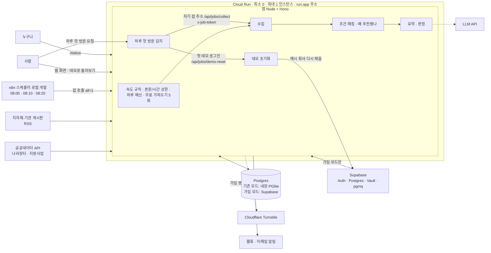

운영(Cloud Run)은 요청이 없으면 인스턴스가 0 으로 줄어들고, 예약 실행도 상주 워커도 없습니다(`APP_SCHEDULER_OFF=1`). 한국 시간으로 날짜가 바뀐 뒤 첫 방문 요청이 앱 자신의 잡 주소(`/api/jobs/collect?all=1`)를 불러 그날 공고를 가져오고, 방문자 응답은 기다리게 하지 않습니다. 예시 회사는 그날 첫 데모 로그인 때 초기화됩니다. 매일 알림·리마인더·지원사업 갱신·자동 결제는 꺼져 있고, 해당 화면에 `?` 안내(비용 절감을 위해 예약 실행을 꺼 두었다는 설명)가 붙습니다. 로컬 개발은 n8n 스케줄러가 기존 잡 주소를 부릅니다.

## 기술 스택

| 기술 | 쓰는 이유 |
|---|---|
| Node 24 | 내장 `node:test`·`--env-file` 로 별도 도구 없이 실행·테스트합니다. |
| Hono (`@hono/node-server`) | 작고 빠른 라우터. 서버 렌더링 HTML 만으로 화면을 만듭니다. 가입 모드는 내장 `hono/csrf`·`hono/secure-headers` 로 폼 전송과 응답 헤더를 보호합니다. |
| Postgres — `pg`, PGlite (`@electric-sql/pglite`) | SQL 방언 하나. 가입 모드는 `pg` 로 Supabase Postgres 에, 기존 모드는 별도 서버 없이 폴더 하나에 저장하는 내장 Postgres(PGlite)에 씁니다. 단위 테스트도 메모리 PGlite 로 Docker 없이 돕니다. |
| pgmq (Supabase 확장) | 가입 모드 매일 작업을 회사별로 나눠 넣는 대기열. 다시 시도·실패 보관을 대기열이 맡습니다. |
| undici · ipaddr.js | 외부 주소를 부를 때 DNS 로 찾은 실제 주소가 내부망·루프백이면 막습니다(리다이렉트마다 다시 확인, 응답 크기 상한). |
| pino | 한 줄짜리 JSON 로그. 비밀번호·토큰·쿠키 값은 지우고 남깁니다. |
| Supabase (Auth · Postgres · Vault) | 가입 모드의 가입·메일 인증·비밀번호 재설정, 회사·구성원 권한(RLS), 인증키 암호화 저장을 직접 만들지 않고 검증된 제품에 맡깁니다. 로컬에서는 CLI 한 줄로 메일 확인 서버까지 함께 뜹니다. |
| `@supabase/supabase-js`, `@supabase/ssr` | 서버에서만 Supabase 를 부르고, 로그인 상태를 쿠키로 유지·갱신합니다. |
| jose | 로그인 토큰을 매 요청마다 원격 호출 없이 서버에서 검증합니다 (공유 비밀 또는 공개키 목록). |
| hono-rate-limiter | 가입·로그인·비밀번호 재설정·초대 수락 요청 횟수를 IP 별로 제한합니다. 횟수는 Postgres 표(`rate_limits`)에 두어 앱을 여러 개 띄워도 함께 셉니다. |
| n8n | 매일 아침 스케줄과 웹훅 전달만 맡습니다. 로직은 앱에 둡니다. |
| Playwright | 앱 E2E 에서 실제 브라우저로 화면을 확인하고 스크린샷을 남깁니다. |
| OpenAI 호환 LLM API | 공고 요약·자격 판정·키워드 제안. 응답의 근거 인용이 원문에 실제로 있는지 검증합니다. |
| fast-xml-parser | 게시판 RSS 2.0 · Atom 피드를 읽습니다. |
| unpdf | 공고 첨부 PDF 에서 글자를 뽑아 요약·판정에 씁니다. |
| fflate · hwp.js | 한글 첨부를 읽습니다. HWPX 는 fflate 로 압축을 풀어 본문 XML 을 fast-xml-parser 로 읽고, HWP 5 는 hwp.js 로 읽습니다. |
| p-retry | 나라장터 호출이 네트워크 문제로 실패하면 간격을 늘려 가며 다시 시도합니다. 조회 한도 초과·인증키 오류는 다시 시도하지 않습니다. |

## 설계 원칙

- **근거가 없으면 `확인 필요`.** 요약과 판정은 공고문 근거 문장을 함께 보여 주고, 근거를 원문에서 찾지 못하면 `확인 필요` 로 표시합니다. 자동으로 읽은 문장만으로 `불가` 라고 단정하지 않습니다.
- **폴더 하나 = 메뉴 하나.** `app/modules/<메뉴>/` 에 `manifest.mjs` 를 두면 기동 때 메뉴가 등록됩니다. 메뉴끼리는 서로 import 하지 않으므로 폴더 하나를 빼도 나머지는 그대로 돕니다.
- **화면은 사용자의 말로.** 화면에 엔진 용어를 쓰지 않습니다. 단위 테스트가 모든 화면 문구에서 금지어를 검사합니다.
- **규칙 먼저, LLM 은 보조.** 추천 여부는 규칙으로 정하고, LLM 은 요약·판정·키워드 제안에만 씁니다. LLM 이 없어도 오늘의 공고와 알림은 정상 동작합니다.
- **인증·비밀 저장은 직접 만들지 않는다.** 비밀번호 해시·세션 발급·키 암호화는 Supabase 에 맡기고, 앱은 토큰 검증과 권한 확인만 합니다.
- **키 없이 테스트.** 단위·E2E 테스트는 모의 나라장터·모의 LLM·모의 게시판·알림 수신기를 띄워 쓰므로 실제 API 키 없이 통과합니다.

## 실행 방법

준비물: Node 24 이상. 매일 알림까지 돌리려면 Docker (n8n 컨테이너). 가입 모드를 로컬에서 돌리려면 Docker 와 Supabase CLI(`supabase`).

```sh
npm ci
npx playwright install chromium   # E2E 용 브라우저 (테스트할 때만)
```

앱은 기동할 때 `MODE legacy`(기존 모드) 또는 `MODE supabase`(가입 모드) 한 줄을 출력합니다. `SUPABASE_URL` 이 비어 있으면 기존 모드입니다.

### 기존 모드 (회사 하나)

프로젝트 루트에 `.env` 를 만듭니다. 실제 키가 들어가므로 커밋하지 않습니다.

```sh
APP_SECRET=긴-임의-문자열        # 예: openssl rand -base64 32
APP_JOB_TOKEN=긴-임의-문자열
# 아래는 선택
NARA_API_KEY=
NOTIFY_WEBHOOK_URL=
LLM_API_BASE=
LLM_API_KEY=
SUPPORT_API_BASE=
SUPPORT_API_KEY=
```

필수는 `APP_SECRET`(로그인 쿠키 서명)과 `APP_JOB_TOKEN`(잡 호출 헤더 `x-job-token` 값) 두 개입니다. 두 모드 모두 필요하고, 없으면 앱이 안내를 출력하고 종료합니다.

띄우기:

```sh
npm run dev:app    # 앱만 — http://localhost:8820
npm run dev        # n8n 컨테이너(편집기 http://localhost:5689) + 앱
npm run dev:down   # n8n 컨테이너 내리기 (앱은 Ctrl+C)
```

`npm run dev` 처럼 앱을 호스트에서 띄우고 n8n 만 컨테이너로 돌릴 때는 `.env` 에 `APP_BASE_URL_FOR_N8N=http://host.docker.internal:8820` 을 적습니다. 적지 않으면 n8n 은 같은 compose 안의 `app` 컨테이너(`http://app:8820`)를 부릅니다.

http://localhost:8820 을 처음 열면 `/setup` 화면에서 회사 이름과 내 이름을 적는 것으로 시작합니다. 상태 확인은 `curl -sf http://localhost:8820/healthz`.

매일 알림을 켜려면 n8n 편집기에서 `workflows/bid-radar-daily.json` 을 가져와(import) 활성화합니다. 가져온 직후에는 꺼져 있습니다.

### 가입 모드 (로컬 Supabase)

1. 로컬 Supabase 스택을 띄웁니다. 처음에는 이미지를 받느라 몇 분 걸립니다. `supabase/migrations/` 의 테이블·권한 정책·Vault 함수가 함께 적용됩니다.

   ```sh
   npm run supabase:start     # supabase start
   supabase status -o env     # 접속 정보 출력
   ```

2. `supabase status -o env` 출력에서 아래 값을 `.env` 로 옮깁니다 (값은 출력에 있는 그대로 복사합니다).

   | 출력의 이름 | `.env` 에 적을 이름 |
   |---|---|
   | `API_URL` | `SUPABASE_URL` (로컬은 `http://localhost:55321`) |
   | `ANON_KEY` | `SUPABASE_ANON_KEY` |
   | `SERVICE_ROLE_KEY` | `SUPABASE_SERVICE_ROLE_KEY` |
   | `JWT_SECRET` | `SUPABASE_JWT_SECRET` |

3. 업무 데이터용 접속 주소를 `APP_DB_URL` 에 적습니다. 출력의 `DB_URL` 에서 사용자를 `app_worker` 로, 비밀번호를 `supabase/seed.sql` 이 정해 둔 로컬 전용 값으로 바꿉니다 (운영 데이터베이스에서는 반드시 다른 비밀번호를 정합니다).

   ```sh
   APP_DB_URL=postgresql://app_worker:<seed.sql 의 비밀번호>@localhost:55322/postgres
   ```

4. `npm run dev:app` 으로 띄우고 http://localhost:8820 을 엽니다. 시작 로그에 `MODE supabase` → `PLATFORM ok` → `LISTENING …` 이 차례로 나옵니다. 첫 화면에서 가입하면 확인 메일은 실제로 나가지 않고 로컬 메일함(http://localhost:55324)에 쌓입니다.

`SUPABASE_URL` 을 적었는데 `SUPABASE_ANON_KEY`·`SUPABASE_SERVICE_ROLE_KEY`·`APP_DB_URL` 중 하나라도 비어 있으면 앱은 시작하지 않습니다. 스택 내리기는 `npm run supabase:stop`, 데이터베이스를 처음 상태로 되돌리기는 `npm run supabase:reset` 입니다. 로컬 포트는 `supabase/config.toml` 에 있습니다 (API 55321, DB 55322, Studio 55323, 메일함 55324).

### 호스티드·셀프호스트 Supabase 로 쓰기

로컬이 아닌 Supabase 에 붙일 때 앱 쪽에서 필요한 것은 아래가 전부입니다. 프로젝트 만들기, 마이그레이션 적용 방법(Supabase CLI 등), SMTP·Vault 설정 같은 Supabase 쪽 절차는 버전마다 다를 수 있으니 공식 문서(https://supabase.com/docs)를 따릅니다.

- `supabase/migrations/` 의 마이그레이션을 그 데이터베이스에 적용합니다. 인증키 저장에 Supabase Vault 를 쓰므로 Vault 가 켜져 있어야 합니다. 저장이 실패하면 연결 설정에 `저장하지 못했습니다` 가 나옵니다.
- 프로젝트 주소·anon 키·service_role 키를 `.env` 의 `SUPABASE_URL`·`SUPABASE_ANON_KEY`·`SUPABASE_SERVICE_ROLE_KEY` 로 옮깁니다.
- 로그인 토큰을 공유 비밀로 서명하는 구성이면 그 값을 `SUPABASE_JWT_SECRET` 에 적습니다. 비워 두면 앱은 `<SUPABASE_URL>/auth/v1/.well-known/jwks.json` 의 공개키 목록으로 검증합니다.
- 가입 확인·비밀번호 재설정 메일은 Supabase 가 보냅니다. 실제로 메일이 나가려면 Supabase 쪽 메일(SMTP) 설정이 필요합니다. 로컬 설정과 같게 하려면 가입 확인 메일 제목을 `입찰 레이더 가입 확인` 으로 둡니다.
- 데이터베이스에서 `pgmq` 확장이 켜져 있어야 하고(마이그레이션이 켭니다), `app_worker` 역할에 로그인 비밀번호를 정해 줍니다. 그 계정의 접속 주소를 `APP_DB_URL` 에 적습니다.
- **`APP_DB_URL` 은 세션 모드 연결이어야 합니다.** 직접 연결(포트 5432) 또는 Supavisor **세션** 풀러 주소를 씁니다. **트랜잭션** 풀러(보통 포트 6543)는 쓰지 않습니다. 앱은 연결 하나에 "지금 회사" 설정을 걸어 두고 쓰는데, 트랜잭션 풀러는 쿼리마다 연결을 바꿔 그 설정이 사라지므로 모든 화면이 비어 보입니다.

### HTTPS 뒤에서 쓰기

공개 주소로 운영할 때는 앱 앞에 리버스 프록시(예: Caddy·nginx)를 두고 TLS 를 거기서 끝냅니다. `.env` 에 `APP_BASE_URL=https://bid.example.com` 처럼 실제 공개 주소를 적습니다. 메일 링크와 폼 전송 출처 검사가 이 주소를 기준으로 하므로, 브라우저가 보는 주소와 다르면 가입·로그인 폼이 거절됩니다. `APP_COOKIE_SECURE=1` 로 로그인 쿠키를 HTTPS 에서만 보내게 하고 (`APP_BASE_URL` 이 `https://` 로 시작하면 기본값도 1), 프록시가 `X-Forwarded-For` 를 넘기면 `APP_TRUST_PROXY` 에 **앱 앞에 있는 프록시 수**(홉 수)를 적어야 요청 횟수 제한이 사용자 IP 별로 동작합니다. `1` 이면 `X-Forwarded-For` 의 **마지막** 값(바로 앞 프록시가 붙인 주소)을, `2` 면 끝에서 두 번째 값을 사용자 IP 로 봅니다. 사용자가 앞쪽 값을 마음대로 적어 보내도 무시됩니다. 프록시 없이 직접 받으면 `0`(기본, 접속한 소켓 주소)입니다. 마지막으로 Supabase 인증 설정에서 사이트 주소를 공개 주소로 바꾸고, 리다이렉트 허용 목록에 `https://bid.example.com/auth/callback` 을 넣습니다 (설정 위치는 공식 문서 참고. 로컬 `supabase/config.toml` 은 `http://localhost:8820` 과 `http://localhost:*/auth/callback` 만 허용합니다).

### 컨테이너로 띄우기

`Dockerfile` 이 앱 이미지를 만들고, `docker-compose.yml` 의 `app` 서비스가 `.env` 를 읽어 8820 포트로 띄웁니다.

```sh
docker compose up -d app n8n
```

- `./data` 폴더가 컨테이너의 `/app/data` 에 연결됩니다. 기존 모드 데이터(`data/pg/`, 컨테이너 안 `APP_DATA_DIR=/app/data/pg`)가 여기에 남으므로 컨테이너를 지워도 데이터는 유지됩니다. 가입 모드 데이터는 `APP_DB_URL` 의 Postgres 에 있습니다.
- compose 는 `.env` 의 `APP_DB_URL` 을 앱 컨테이너에 넘깁니다. 컨테이너 안에서 닿는 주소여야 합니다(로컬 Supabase 라면 `localhost` 대신 `host.docker.internal`).
- 예전 판의 `data/bid-radar.sqlite` 가 남아 있고 `data/pg/` 가 아직 없으면 앱은 시작하지 않고 옮기는 방법을 안내합니다. 아래 "SQLite 에서 Postgres 로 옮기기" 를 먼저 합니다.
- n8n 은 기본으로 `http://app:8820` 으로 앱을 부릅니다. 앱을 컨테이너가 아닌 호스트에서 띄운다면 `APP_BASE_URL_FOR_N8N` 으로 주소를 바꿉니다.
- 컨테이너 안에서 `localhost` 는 컨테이너 자신입니다. 가입 모드라면 `SUPABASE_URL` 에 컨테이너에서 닿는 주소(호스티드 프로젝트 주소 등)를 적습니다.
- 이미지에 상태 확인(`/healthz`)이 들어 있어 `docker compose ps` 에서 healthy 여부를 볼 수 있습니다.

### 기존 설치를 옮기기

기존 모드로 쓰던 회사를 가입 모드의 첫 회사로 옮깁니다. 대표가 먼저 가입하고 메일 인증까지 마친 뒤, 운영자가 한 번 실행합니다. `.env` 에 `SUPABASE_URL`·`SUPABASE_SERVICE_ROLE_KEY` 가 있어야 합니다.

```sh
npm run admin -- migrate-legacy --db data/bid-radar.sqlite --owner-email owner@example.com
npm run admin -- list                         # 회사 id · 이름 · 구성원 수
npm run admin -- invite-links <회사 id>       # 아직 들어오지 않은 구성원의 초대 링크 다시 발급
```

- `migrate-legacy` 는 Supabase 에 회사와 대표를 만들고, 업무 데이터를 옮길 `node scripts/migrate-sqlite.mjs …` 명령을 출력합니다. 앱을 열기 전에 그 명령을 실행합니다(관리자 주소가 필요합니다. 아래 절 참고). 원본 파일은 읽기만 합니다. 회사 이름은 기존 설정의 회사 이름을 쓰고, `--name OO조경` 으로 바꿀 수 있습니다.
- 대표 외 구성원은 새 초대 링크가 이름과 함께 출력됩니다. 각자 링크로 가입(또는 로그인)한 뒤 들어오면 됩니다.
- `.env` 에 `NARA_API_KEY`·`LLM_API_BASE`·`LLM_API_KEY`·`LLM_MODEL`·`SUPPORT_API_BASE`·`SUPPORT_API_KEY` 가 있으면 그 회사의 인증키로 Vault 에 복사합니다. 복사하지 않으려면 `--no-keys` 를 붙입니다. 출력에는 옮긴 키의 이름과 개수만 나오고 값은 나오지 않습니다.
- `invite-links` 는 새 링크를 발급하면서 옛 링크를 쓸 수 없게 합니다.
- 종료 코드는 0 성공, 1 실패, 2 대표 계정 없음입니다. 대표 이메일로 메일 인증까지 마친 계정이 없으면 `먼저 가입과 메일 인증을 마쳐 주세요` 를 출력하고 2 로 끝납니다.

### SQLite 에서 Postgres 로 옮기기

예전 판은 업무 데이터를 SQLite 파일에 두었습니다(기존 모드 `data/bid-radar.sqlite`, 가입 모드 `data/ws/<회사 id>.sqlite`). 지금은 둘 다 Postgres 입니다. `scripts/migrate-sqlite.mjs` 가 옮기며, 원본은 읽기만 하고 여러 번 돌려도 결과가 같습니다(이미 있는 행은 건너뜁니다). 표마다 `<표> read=<n> inserted=<n> skipped=<n>` 를, 끝에 `MIGRATE_OK <파일 수> files` 를 출력합니다. 실패하면 그 파일은 되돌리고 종료 코드 1 입니다. 먼저 `--dry` 를 붙여 읽기만 해 볼 수 있습니다.

기존 모드 (앱을 멈춘 뒤):

```sh
node scripts/migrate-sqlite.mjs --from data/bid-radar.sqlite \
  --workspace 00000000-0000-0000-0000-000000000001 --to-dir data/pg
```

- `--workspace` 값은 기존 모드의 고정 회사 id 입니다. 구성원도 함께 옮겨지므로 `APP_SECRET` 을 바꾸지 않았다면 초대 링크로 들어온 사람은 다시 들어올 필요가 없습니다.
- 옮긴 뒤 `data/pg/` 가 생기면 앱은 그쪽을 씁니다. 다른 위치를 쓰려면 `APP_DATA_DIR` 로 지정합니다. `APP_DATA_DIR` 이나 `APP_DB_PATH` 가 SQLite 파일을 가리키면 앱은 `scripts/migrate-sqlite.mjs` 안내를 출력하고 종료 코드 1 로 멈춥니다.

가입 모드 (회사별 파일 전부):

```sh
node scripts/migrate-sqlite.mjs --all data/ws --to-url "postgresql://postgres:<관리자 비밀번호>@<호스트>:<포트>/postgres"
```

- `--to-url` 에는 **관리자 계정**(`postgres`) 주소를 씁니다. 앱용 `app_worker` 계정은 일련번호(시퀀스) 권한이 없어 옮기기에 쓸 수 없습니다. 로컬은 `supabase status -o env` 의 `DB_URL` 을 그대로 씁니다. 주소에 비밀번호가 들어가므로 셸 기록에 남지 않게 환경변수로 넘기는 편이 좋습니다.
- 회사 소속·초대는 이미 Supabase 에 있으므로 옮기지 않습니다(구성원 표는 기존 모드 `--to-dir` 에서만 옮김).

### 상태 확인과 로그

- `GET /healthz` → 항상 `200 {"status":"ok"}` (프로세스가 살아 있는지만. 컨테이너 상태 확인용).
- `GET /readyz` → 데이터베이스·작업 대기열·로그인 서버를 실제로 확인해 `200 {"status":"ok","mode":…,"checks":{"db":{"ok":true,…},…}}`, 하나라도 실패하면 `503` 과 `"status":"degraded"`. 항목마다 2초 제한, 결과는 10초 동안 재사용합니다. 기존 모드는 `db` 만 봅니다. 로드밸런서의 준비 확인에는 이쪽을 씁니다.
- 로그는 표준 출력에 한 줄짜리 JSON 으로 나옵니다(`APP_LOG_LEVEL` 로 양 조절). 요청마다 `{"msg":"request","method","path","status","ms","requestId",…}` 한 줄이 남고, 응답 헤더 `x-request-id` 와 같은 값이라 문의가 오면 그 줄을 찾을 수 있습니다. 비밀번호·토큰·쿠키·키 값과 쿼리 문자열은 남기지 않습니다. 시작할 때는 `MODE legacy`/`MODE supabase`, `LISTENING http://localhost:<포트>` 가 `msg` 로 나옵니다.

### 요금제와 결제

가입 모드 전용입니다. 기존 모드(회사 하나)에는 요금제·결제가 없고 구성원·공고 소스·키워드 수 한도도 없습니다.

| 요금제 | 월 요금 (30일) | 구성원 | 공고 소스 | 키워드 | 알림 이메일 |
|---|---|---|---|---|---|
| 무료 체험 | 0원 (`APP_TRIAL_DAYS`, 기본 14일) | 3 | 2 | 10 | 2 |
| 스타터 | 29,000원 | 3 | 3 | 30 | 3 |
| 팀 | 79,000원 | 10 | 10 | 100 | 10 |

- 회사를 만들면 바로 무료 체험이 시작됩니다. 한도는 서버가 저장 전에 검사하고, 넘으면 "요금제를 올리면 더 쓸 수 있습니다" 라고 안내합니다.
- 대표만 왼쪽 메뉴 **요금제**(`/billing`)에서 카드를 등록하고 요금제를 고르고 해지합니다. 카드는 토스페이먼츠 결제창에서 등록하고, 앱은 카드 요약(`****1234`)만 보여 줍니다. 빌링키는 Supabase Vault 에 보관합니다.
- 체험 중에 요금제를 고르면 바로 첫 결제를 합니다. 실패해도 체험은 그대로 남습니다.
- 체험이 끝나면 매일 결제 잡(`GET /api/jobs/billing`, 헤더 `x-job-token`)이 기간 말 자동결제를 합니다. 실패하면 상태가 `past_due` 가 되고 `APP_BILLING_RETRY_DAYS`(기본 `1,3,7`) 간격으로 다시 시도합니다. 세 번 다 실패하면 `expired` 가 됩니다.
- 체험이 끝났는데 결제하지 않았거나 `expired` 가 되면 회사가 잠깁니다. 요금제·내 계정·약관 화면만 열리고 매일 알림도 멈춥니다. 카드를 등록하고 결제하면 바로 풀립니다.
- 해지는 기간 말에 적용됩니다(`/billing/cancel`, 기간 안에는 `/billing/resume` 으로 되돌림). 환불·일할 계산 화면은 없습니다.
- 토스 웹훅 주소는 `https://<공개 주소>/webhooks/toss` 입니다. 앱은 웹훅 본문을 믿지 않고 결제 조회(`GET /v1/payments/{paymentKey}`)로 다시 확인하며, 같은 이벤트는 한 번만 처리합니다.

설정 순서

1. 토스페이먼츠 개발자센터에서 테스트 키(`test_ck_…`·`test_sk_…`)를 받아 `.env` 의 `TOSS_CLIENT_KEY`·`TOSS_SECRET_KEY` 에 적습니다. 실제 출시에는 자동결제(빌링) 계약이 켜진 라이브 키(`live_ck_…`·`live_sk_…`)를 씁니다.
2. 둘 중 하나라도 비어 있으면 요금제 화면에 "결제 준비 안 됨" 이 나오고 카드 등록 버튼이 꺼집니다. 체험·한도는 그대로 동작합니다.
3. 결제 잡을 매일 한 번 부릅니다. 무료 데모 운영(`APP_SCHEDULER_OFF=1`)은 예약 실행이 없어 자동 결제를 하지 않습니다(결제는 카드 등록 때 한 번, 토스 테스트 키). 수동으로 돌리려면 `curl -H "x-job-token: $APP_JOB_TOKEN" http://localhost:8820/api/jobs/billing`.
4. 테스트는 실제 토스에 붙지 않고 모의 서버(`TOSS_API_BASE`)로 돕니다.

### 이메일 알림

가입 모드 전용입니다. 매일 알림 3종(오늘의 공고·마감 임박·지원사업)을 웹훅과 별도로 이메일로도 보냅니다.

1. Resend(https://resend.com)에 가입하고 보낼 도메인을 추가해 DNS(SPF·DKIM)를 확인받습니다.
2. API 키를 만들어 `.env` 의 `EMAIL_API_KEY` 에, 보내는 주소를 `EMAIL_FROM=입찰 레이더 <alerts@example.com>` 형식으로 적습니다. 둘 중 하나라도 비면 이메일 채널은 꺼지고 알림 설정에 "준비 안 됨" 이 보입니다.
3. 알림 설정 화면의 **수신 이메일** 칸에 받을 주소를 쉼표로 구분해 적습니다. 개수는 요금제 한도(체험 2·스타터 3·팀 10)를 넘을 수 없습니다.

- 같은 날 같은 알림은 주소마다 한 번만 보냅니다(잡을 다시 불러도 중복 발송 없음).
- 메일 아래에 수신거부 링크(`/unsubscribe`)가 있고 `List-Unsubscribe` 헤더도 붙습니다. 링크는 `APP_SECRET` 으로 서명돼 있어 주소를 바꾸면 거절됩니다. 링크를 열면(GET) 바로 수신거부됩니다. 메일 앱의 원클릭 수신거부(POST)는 지원하지 않습니다.
- 가입 확인·비밀번호 재설정 메일은 앱이 아니라 Supabase 가 보냅니다. 운영에서는 Supabase Auth 의 커스텀 SMTP 도 Resend 로 맞춥니다(`deploy/supabase/PRODUCTION.md`).

### 이용약관과 사업자 정보

- `/terms`(이용약관)·`/privacy`(개인정보처리방침)는 로그인 없이 열리고, 모든 화면 아래 푸터에 사업자 정보가 나옵니다.
- 사업자 정보는 환경변수로만 넣습니다: `BUSINESS_NAME`(상호)·`BUSINESS_REP`(대표자)·`BUSINESS_REG_NO`(사업자등록번호)·`BUSINESS_MAIL_ORDER_NO`(통신판매업 신고번호)·`BUSINESS_ADDRESS`·`BUSINESS_EMAIL`·`BUSINESS_PHONE`·`PRIVACY_OFFICER`(개인정보 보호책임자). 비어 있는 항목은 `미설정` 으로 보입니다. 저장소 파일에는 실제 값을 적지 않습니다.
- 가입 모드에서는 가입할 때 이용약관·개인정보처리방침 필수 동의 2개를 받아 버전과 함께 기록합니다.
- 약관을 고치면 `LEGAL_TERMS_VERSION`·`LEGAL_PRIVACY_VERSION`(기본 `2026-11-03`)을 새 날짜로 바꿉니다. 버전이 바뀌면 사용자는 로그인 뒤 재동의 화면(`/consent`)을 거쳐야 다른 화면으로 갑니다.
- 들어 있는 약관·방침은 **초안**입니다. 실제로 판매하기 전에 법률 검토를 받으세요.

### 운영 배포 (Cloud Run + Supabase)

실제 고객에게 여는 절차는 [`deploy/README.md`](deploy/README.md) 를 위에서부터 따릅니다. 요약하면 다음과 같습니다.

- 구성: Cloud Run 서비스 1개(최소 0·최대 1 인스턴스, 요청 처리 중에만 CPU, 메모리 512Mi, 동시 요청 40, `APP_WORKER=0`, `APP_SCHEDULER_OFF=1`) + Supabase 운영 프로젝트(세션 풀러 연결) + Secret Manager 비밀 10개 + GitHub Actions(WIF) 자동 배포. 공개 주소는 Cloud Run 이 주는 `…run.app` 주소 그대로이고, 예약 실행·도메인 매핑·부하분산기는 없습니다. n8n 도 띄우지 않습니다.
- 수집: 하루 첫 방문 요청이 앱 자신의 `/api/jobs/collect?all=1`(헤더 `x-job-token`)을 부르고, 그 요청 안에서 회사마다 오늘 공고를 가져옵니다(알림은 보내지 않음). 한 번에 최대 `APP_DAY_START_MAX_MS`(기본 240초)까지 돌고 남은 회사는 다음 방문이 이어 갑니다. 진행 상황은 `/status` 의 `오늘 수집` 줄과 `/status.json` 의 `collect` 필드에 보입니다.
- `오늘 공고 가져오기` 버튼은 회사마다 `APP_FREE_COLLECTS`(기본 5)회 무료이고, 남은 횟수가 버튼 옆에 보입니다. 다 쓰면 버튼이 꺼지고 `요금제 보기` 로 안내합니다. 유료 구독(`active`·`past_due`)은 무제한입니다.
- 순서: 배포 서비스 계정·WIF(`deploy/gcp/setup.sh`) → `.env.production` 채우기(`deploy/env.production.example` 복사, DB 는 Session pooler) → 첫 이미지 로컬 빌드·push(`linux/amd64`) → `deploy/gcp/apply-env.sh` 로 마이그레이션·비밀·평문 env 반영과 공개 → GitHub Variables → 스모크.
- 배포 방식: 이후 main 에 push 되고 `ci` 가 성공하면 `.github/workflows/deploy.yml` 이 이미지를 빌드해 **이미지만** 바꿉니다(env·비밀·스케일 설정은 그대로, 이미지에 들어가는 파일이 안 바뀐 커밋은 건너뜀). env·비밀을 바꿀 때는 `.env.production` 을 고치고 `bash deploy/gcp/apply-env.sh --skip-db`.
- 비밀(`APP_SECRET`·`APP_JOB_TOKEN`·`SUPABASE_SERVICE_ROLE_KEY`·`APP_DB_URL`·`TOSS_SECRET_KEY`·`EMAIL_API_KEY`·`NARA_API_KEY`·`LLM_API_KEY`·`SUPPORT_API_KEY`·`TURNSTILE_SECRET_KEY`)은 Secret Manager 에, 나머지는 평문 env 로 둡니다. 전체 목록은 `deploy/env.production.example`.
- 배포 설정 점검: `node scripts/check-deploy.mjs --example` → `DEPLOY_CONFIG_OK`. `deploy/gcp/setup.sh`·`deploy/gcp/apply-env.sh` 는 `--dry-run` 으로 먼저 훑어봅니다. 밖에서 살아 있는지 볼 때는 `/readyz` 를 씁니다(Cloud Run 프론트가 외부 `/healthz` 요청을 가로챔).
- `/api/jobs/<잡>?all=1&wait=1` 은 대기열에 넣은 뒤 같은 요청 안에서 최대 `APP_JOB_WAIT_MS`(기본 240초) 동안 대기열을 비우고 `200 { runId, enqueued, skipped, processed, remaining }` 을 돌려줍니다. 남은 작업은 다음 호출이 이어서 처리합니다. `wait` 없이 부르면 예전처럼 `202` 입니다.

### 공개 운영 시 비용 방어

공개 주소에 데모를 열어 두어도 하루 비용이 위로 막히도록 코드와 인프라 양쪽에 상한을 둡니다. 값은 모두 환경변수이고 `deploy/README.md` 의 `비용 상한`·`예산 알림` 절에 운영 체크리스트가 있습니다.

| 장치 | 변수 | 기본값 | 넘으면 |
|---|---|---|---|
| 하루 알림 메일 수 (KST 자정 기준) | `APP_DAILY_MAX_EMAIL` | `200` | 그날 남은 메일은 보내지 않고 발송 기록에 `budget` 으로 남김 |
| 하루 LLM 호출 수 | `APP_DAILY_MAX_LLM` | `200` | 요약·추천 키워드·자격 판정이 "준비 안 됨" |
| 하루 가입 수 | `APP_DAILY_MAX_SIGNUP` | `50` | `오늘 가입 접수를 마감했습니다. 내일 다시 시도해 주세요.` (429) |
| 하루 데모 로그인 수 | `APP_DAILY_MAX_DEMO_LOGIN` | `500` | 데모 버튼이 내일 다시 오라고 안내 (429) |
| 속도 규칙 배수 | `APP_RATE_SCALE` | `1` | 아래 규칙 횟수에 곱함. 넘으면 429 + `Retry-After` |
| 요청 본문 상한 | `APP_BODY_LIMIT_BYTES` | `262144` (256KiB) | `보낸 내용이 너무 큽니다` (413) |
| 요청 처리 상한 (잡·웹훅 제외) | `APP_REQUEST_TIMEOUT_MS` | `30000` | `처리 시간이 길어 중단했습니다` (504) |
| 만들 수 있는 회사 수 | `APP_MAX_WORKSPACES` | `50` | 회사 만들기 거절 |
| 회사별 무료 공고 가져오기 | `APP_FREE_COLLECTS` | `5` | 버튼이 꺼지고 `무료 가져오기 5회를 모두 썼습니다` + `요금제 보기` |
| 예약 실행 없음 | `APP_SCHEDULER_OFF` | 운영 `1` | 수집은 하루 첫 방문 때, 알림·자동 결제는 보내지 않음 |

하루 예산 4개는 `0` 이면 무제한이고, 따로 표를 만들지 않고 요청 횟수 표(`rate_limits`)에 `budget:<종류>:<KST 날짜>` 행으로 셉니다. 데모 회사에서는 LLM 을 외부 호출 없이 거절합니다.

속도 규칙 (인스턴스가 여러 개여도 같은 Postgres 표로 함께 셈)

| 규칙 | 기준 | 횟수 | 대상 |
|---|---|---|---|
| 로그인·가입 | IP | 15분에 10번 | `/signup` `/login` `/reset` `/join/*` `/account/password` `/account/delete` |
| 데모 로그인 | IP | 15분에 20번 | `/demo/login` |
| 잡 호출 | IP | 1시간에 60번 | `/api/jobs/*` |
| 자동 요약·키워드·판정 | 회사 | 1시간에 30번 | `/summary/*/run` `/keywords/suggest` `/company/verdict` |
| 연결 확인 | 회사 | 1시간에 10번 | `/connections/*/check` |
| 공고 가져오기 | 회사 | 1시간에 6번 | `/today/run` |
| 구성원 초대 | 회사 | 1시간에 10번 | `/assign/members` |

- **가입 봇 확인**: Cloudflare Turnstile(무료)을 씁니다. `TURNSTILE_SITE_KEY`·`TURNSTILE_SECRET_KEY` 가 둘 다 있을 때만 가입 화면에 확인 상자가 붙고, 서버가 가입 전에 한 번 검증합니다. 실패하면 `사람인지 확인하지 못했습니다. 다시 시도해 주세요.` (400). 키가 없으면 꺼져 있습니다.
- **인프라 상한**: 최대 인스턴스 1 × 동시 요청 40, 요청이 없으면 인스턴스 0, 예약 실행·부하분산기 없음. 결제 계정 예산 알림(`gcloud billing budgets create`)을 함께 겁니다.

### 환경변수

| 변수 | 모드 | 용도 | 비어 있으면 |
|---|---|---|---|
| `APP_SECRET` | 공통 (필수) | 로그인 쿠키 서명 | 시작하지 않음 |
| `APP_JOB_TOKEN` | 공통 (필수) | 잡 호출 헤더 `x-job-token` 값 | 시작하지 않음 |
| `NARA_API_KEY` | 공통 | 공공데이터포털 나라장터 입찰공고 API 의 **일반 인증키(Decoding)**. Encoding 키는 이중 인코딩으로 인증 오류가 납니다 | 나라장터 수집이 안 되고 화면에 "나라장터 인증키가 없습니다" 안내 |
| `NARA_API_BASE` | 공통 | 나라장터 API 주소 | `https://apis.data.go.kr/1230000/ad/BidPublicInfoService` |
| `NARA_BID_OPERATION` | 공통 | 가져올 공고 종류 | `getBidPblancListInfoCnstwk` (공사) |
| `NARA_ROWS` | 공통 | 한 번에 받을 공고 수 (API 상한 999) | `500` |
| `NARA_MAX_PAGES` | 공통 | 하루치 조회 하나당 페이지 상한. 넘으면 "일부만 가져왔습니다" 알림 | `20` |
| `NARA_BACKFILL_MAX_DAYS` | 공통 | 수집을 빠뜨린 날을 거슬러 채우는 최대 일수 | `7` |
| `NARA_RETRY` | 공통 | 네트워크 오류 시 다시 시도하는 횟수 | `3` |
| `NARA_PRESTD_BASE` | 공통 | 사전규격 서비스 주소 (공공데이터포털에서 활용 신청 필요) | `https://apis.data.go.kr/1230000/ao/HrcspSsstndrdInfoService` |
| `NARA_SCSBID_BASE` | 공통 | 개찰결과 서비스 주소 (지난 개찰 메뉴, 활용 신청 필요) | `https://apis.data.go.kr/1230000/as/ScsbidInfoService` |
| `NARA_AWARD_OPERATION` | 공통 | 지난 개찰 메뉴가 낙찰 확정 업체를 가져오는 오퍼레이션 | `getScsbidListSttusCnstwk` (공사 낙찰 목록) |
| `NOTIFY_WEBHOOK_URL` | 공통 | 알림 JSON 을 POST 로 받을 기본 주소. 알림 설정의 "알림 받을 곳"이 있으면 그쪽이 우선 | 받을 곳이 없으면 매일 알림이 전송되지 않음 (화면·미리보기는 정상) |
| `APP_PORT` | 공통 | 앱 포트. `0` 이면 빈 포트 | `8820` |
| `APP_BASE_URL` | 공통 | 알림 본문 링크의 앞부분. 가입 모드에서는 메일 링크와 폼 출처 검사의 기준 주소 | `http://localhost:<APP_PORT>` (가입 모드는 요청 주소) |
| `APP_BASE_URL_FOR_N8N` | 공통 | n8n 컨테이너가 앱을 부를 주소 | `http://app:8820` (앱을 호스트에서 띄우면 `http://host.docker.internal:8820` 으로) |
| `APP_DATA_DIR` | 기존 모드 | 내장 Postgres(PGlite) 데이터 폴더 | `data/pg` |
| `APP_FETCH_ALLOW_HOSTS` | 공통 | 내부 주소 차단의 예외 호스트 이름(쉼표 구분, 소문자 완전 일치). 같은 망의 사내 게시판을 쓸 때나 테스트에서만 | 예외 없음 — 내부망·루프백 주소는 모두 차단 |
| `APP_FETCH_MAX_BYTES` | 공통 | 외부 응답 한 번에 읽는 최대 바이트 | `5242880` (5MB) |
| `APP_LOG_LEVEL` | 공통 | 로그 양 (`debug`·`info`·`warn`·`error`·`silent`) | `info` |
| `LLM_API_BASE` | 공통 | OpenAI 호환 API 주소 (`/v1` 까지) | 요약·판정·키워드 추천이 "준비 안 됨"으로 표시. 나머지는 정상 |
| `LLM_API_KEY` | 공통 | 위 API 의 키 | 위와 같음 |
| `LLM_MODEL` | 공통 | 모델 이름 | `qwen3.7-flash` |
| `SUPPORT_API_BASE` | 공통 | 기업마당 지원사업 API 주소 | 지원사업 수집 건너뜀 (입찰 알림에는 영향 없음) |
| `SUPPORT_API_KEY` | 공통 | 기업마당 지원사업 API 키 | 위와 같음 |
| `SUPABASE_URL` | 가입 모드 | Supabase API 주소. **이 값이 있으면 가입 모드로 시작** | 기존 모드 |
| `SUPABASE_ANON_KEY` | 가입 모드 (필수) | Supabase 공개(anon) 키 | `SUPABASE_URL` 이 있으면 시작하지 않음 |
| `SUPABASE_SERVICE_ROLE_KEY` | 가입 모드 (필수) | 서버 전용 키. 인증키 복호화·모든 회사 잡 순회·초대 조회에 씀. 화면·로그에 나가지 않음 | `SUPABASE_URL` 이 있으면 시작하지 않음 |
| `SUPABASE_JWT_SECRET` | 가입 모드 | 로그인 토큰을 공유 비밀(HS256)로 검증 | `<SUPABASE_URL>/auth/v1/.well-known/jwks.json` 공개키로 검증 |
| `APP_COOKIE_SECURE` | 가입 모드 | `1` 이면 로그인 쿠키를 HTTPS 에서만 보냄 | `APP_BASE_URL` 이 `https://` 면 1, 아니면 0 |
| `APP_TRUST_PROXY` | 가입 모드 | 앱 앞 프록시 수(홉 수). `1` 이면 `X-Forwarded-For` 의 마지막 값, `2` 면 끝에서 두 번째 값을 사용자 IP 로 보고 요청 횟수를 셈 | `0` — 접속한 소켓 주소 기준 |
| `APP_SIGNUP_MODE` | 가입 모드 | `open`(누구나) · `code`(가입 코드 필요) · `closed`(초대 링크로만 가입) | `open` |
| `APP_SIGNUP_CODE` | 가입 모드 | `APP_SIGNUP_MODE=code` 일 때 가입 화면에서 받을 코드 | - |
| `APP_SHARED_KEYS` | 가입 모드 | `1` 이면 회사가 인증키를 등록하지 않았을 때 위 `NARA_API_KEY`·`LLM_*`·`SUPPORT_*` 를 공용 키로 씀 | `0` — 회사마다 자기 키 |
| `APP_MAX_WORKSPACES` | 가입 모드 | 만들 수 있는 회사 수 상한 | `50` |
| `APP_RUNTIME_CACHE` | 가입 모드 | 동시에 열어 두는 회사 수 (오래 안 쓴 회사부터 닫음) | `20` |
| `APP_DB_URL` | 가입 모드 (필수) | 업무 데이터 Postgres 주소. `app_worker` 계정, **세션 모드**(직접 연결 또는 세션 풀러). Cloud Run 에서는 세션 풀러(5432)만 됩니다(직접 연결 주소는 IPv6 전용) | `SUPABASE_URL` 이 있으면 시작하지 않음 |
| `APP_DB_POOL` | 가입 모드 | 앱 하나가 여는 최대 연결 수 | `10` |
| `APP_WORKER` | 가입 모드 | `0` 이면 이 앱에서 워커를 돌리지 않음(대기열에 넣기만). 앱을 여러 개 띄울 때 일부만 워커로. 운영(Cloud Run)은 `0` 이고 잡 요청의 `wait=1` 이 대기열을 비움 | `1` |
| `APP_WORKER_POLL_MS` | 가입 모드 | 워커가 대기열을 보는 간격(ms) | `5000` |
| `APP_WORKER_CONCURRENCY` | 가입 모드 | 워커가 동시에 돌리는 회사 수 | `2` |
| `APP_JOB_TIMEOUT_MS` | 가입 모드 | 회사 하나의 작업 시간 제한(ms). 넘으면 실패로 보고 다시 시도 | `300000` (5분) |
| `APP_JOB_WAIT_MS` | 가입 모드 | 잡 호출에 `wait=1` 을 붙였을 때 요청 안에서 대기열을 비우는 최대 시간(ms) | `240000` (4분) |
| `APP_DEMO` | 가입 모드 | `1` 이면 데모 켜짐(첫 화면 `데모로 둘러보기` 버튼·`/demo/login`·`/api/jobs/demo-reset`) | 꺼짐 — 버튼 없음, 두 주소 404 |
| `APP_DEMO_EMAIL_DOMAIN` | 가입 모드 | 데모 계정 이메일 도메인 (`demo-owner@`·`demo-staff-a@`·`demo-staff-b@`) | `demo.example.com` |
| `APP_PLATFORM_ADMIN_EMAILS` | 가입 모드 | 운영 현황(`/admin`)을 볼 수 있는 이메일 (쉼표 구분, 대소문자 무시) | 아무도 못 봄 (404) |
| `TURNSTILE_SITE_KEY` | 가입 모드 | Cloudflare Turnstile 사이트 키 (가입 봇 확인) | 봇 확인 꺼짐 |
| `TURNSTILE_SECRET_KEY` | 가입 모드 | Turnstile 서버 검증 키. 화면·로그에 나가지 않음. 위 키와 둘 다 있어야 켜짐 | 봇 확인 꺼짐 |
| `TURNSTILE_VERIFY_URL` | 가입 모드 | Turnstile 검증 주소 (테스트는 모의 서버 주소) | `https://challenges.cloudflare.com/turnstile/v0/siteverify` |
| `APP_BODY_LIMIT_BYTES` | 가입 모드 | 요청 본문 상한(바이트). 넘으면 413 | `262144` (256KiB) |
| `APP_REQUEST_TIMEOUT_MS` | 가입 모드 | 요청 처리 상한(ms, 잡·웹훅 제외). 넘으면 504 | `30000` |
| `APP_RATE_SCALE` | 가입 모드 | 속도 규칙 횟수에 곱하는 배수 | `1` |
| `APP_DAILY_MAX_EMAIL` | 가입 모드 | KST 하루 알림 메일 상한 (`0` = 무제한) | `200` |
| `APP_DAILY_MAX_LLM` | 가입 모드 | KST 하루 LLM 호출 상한 (`0` = 무제한) | `200` |
| `APP_DAILY_MAX_SIGNUP` | 가입 모드 | KST 하루 가입 상한 (`0` = 무제한) | `50` |
| `APP_DAILY_MAX_DEMO_LOGIN` | 가입 모드 | KST 하루 데모 로그인 상한 (`0` = 무제한) | `500` |
| `APP_SCHEDULER_OFF` | 가입 모드 | `1` 이면 예약 실행 없음: 하루 첫 방문이 공고 수집을, 첫 데모 로그인이 데모 초기화를 시작하고, 알림·자동 결제 화면에 `?` 안내가 붙음. 운영은 `1`. 이때 `APP_BASE_URL` 필수(첫 방문 수집 주소, 요청 Host 는 쓰지 않음 — 비었거나 잘못되면 첫 방문 수집은 꺼지고 경고 로그 1회). 로컬은 `APP_BASE_URL=http://localhost:8820` 과 `APP_FETCH_ALLOW_HOSTS=localhost` 를 함께 줌 | 꺼짐 — 예약 실행(로컬 n8n)이 잡 주소를 부르는 기존 동작 |
| `APP_FREE_COLLECTS` | 가입 모드 | 회사별 무료 `공고 가져오기` 횟수 (`0` = 무제한, 유료 구독은 무제한) | `5` |
| `APP_DAY_START_MAX_MS` | 가입 모드 | `/api/jobs/collect` 가 한 요청 안에서 쓰는 최대 시간(ms). 남은 회사는 다음 방문이 이어 감 | `240000` |
| `APP_DAY_START_KICK_WAIT_MS` | 가입 모드 | 첫 방문 요청이 수집 시작 수락을 기다리는 시간(ms) | `1500` |
| `APP_DAY_START_CLAIM_TTL_MS` | 가입 모드 | 수집 `진행 중` 표시의 유효 시간(ms). 지나면 다음 방문이 다시 시작 | `600000` |
| `APP_DAY_START_RESET_WAIT_MS` | 가입 모드 | 데모 로그인이 그날 첫 초기화를 기다리는 시간(ms) | `20000` |
| `TOSS_CLIENT_KEY` | 가입 모드 | 토스페이먼츠 브라우저 SDK 키 (`test_ck_…`/`live_ck_…`) | 요금제 화면에 "결제 준비 안 됨", 카드 등록 버튼 꺼짐 |
| `TOSS_SECRET_KEY` | 가입 모드 | 토스페이먼츠 서버 시크릿 키 (`test_sk_…`/`live_sk_…`). 화면·로그에 나가지 않음 | 위와 같음 |
| `TOSS_API_BASE` | 가입 모드 | 토스페이먼츠 API 주소 (테스트는 모의 서버 주소) | `https://api.tosspayments.com` |
| `APP_TRIAL_DAYS` | 가입 모드 | 무료 체험 일수 | `14` |
| `APP_BILLING_RETRY_DAYS` | 가입 모드 | 결제 실패 뒤 다시 시도하는 간격(일, 쉼표 구분) | `1,3,7` |
| `EMAIL_API_BASE` | 가입 모드 | 이메일 API(Resend) 주소 | `https://api.resend.com` |
| `EMAIL_API_KEY` | 가입 모드 | 이메일 API 키 (Bearer) | 이메일 채널 꺼짐, 알림 설정에 "준비 안 됨" |
| `EMAIL_FROM` | 가입 모드 | 보내는 주소 (`입찰 레이더 <alerts@example.com>` 형식) | 위와 같음 |
| `BUSINESS_NAME` `BUSINESS_REP` `BUSINESS_REG_NO` `BUSINESS_MAIL_ORDER_NO` `BUSINESS_ADDRESS` `BUSINESS_EMAIL` `BUSINESS_PHONE` `PRIVACY_OFFICER` | 공통 | 푸터·약관에 나오는 사업자 정보 (상호·대표자·사업자등록번호·통신판매업 신고번호·주소·이메일·전화·개인정보 보호책임자) | 항목마다 `미설정` 표시 |
| `LEGAL_TERMS_VERSION` | 공통 | 현재 이용약관 버전. 바꾸면 가입 모드 사용자에게 재동의를 받음 | `2026-11-03` |
| `LEGAL_PRIVACY_VERSION` | 공통 | 현재 개인정보처리방침 버전. 바꾸면 위와 같음 | `2026-11-03` |

더 이상 쓰지 않는 변수

| 변수 | 대신 |
|---|---|
| `APP_DB_PATH` | `APP_DATA_DIR`. 이 값이 SQLite 파일을 가리키면 앱이 옮기라는 안내를 출력하고 시작하지 않습니다 |
| `APP_WS_DIR` | 가입 모드 업무 데이터는 `APP_DB_URL` 의 Postgres 에 있습니다. 예전 파일은 `migrate-sqlite.mjs --all` 로 옮깁니다 |

## 사용 방법

### 첫 5분 (기존 모드)
1. 처음 주소를 열면 **회사 이름**(예: OO조경)과 **내 이름**(예: 대표)을 적고 저장합니다.
2. **알림 설정** 화면에서 업종 키워드 · 지역 · 예산 · 알림 받을 곳을 적고 저장한 뒤 `오늘 것 미리보기` 를 누릅니다.
3. **오늘의 공고** 에서 조건에 맞는 공고와 `왜 추천: …` 을 보고 조건이 맞는지 감을 잡습니다.
4. 다음 날 아침 8시쯤부터 알림이 갑니다.

### 가입과 회사 만들기 (가입 모드)
1. 첫 화면에서 `가입하기` 를 누르고 이메일, 비밀번호(8자 이상), 내 이름을 적습니다. `APP_SIGNUP_MODE=code` 인 설치는 가입 코드도 적습니다.
2. 메일함에서 **"입찰 레이더 가입 확인"** 메일의 링크를 누릅니다. 인증 전에는 로그인되지 않습니다.
3. 링크를 누르면 **회사 만들기** 화면이 열립니다. 회사 이름(예: OO조경)과 내 이름을 적으면 그 회사의 대표가 되고 **알림 설정** 화면으로 넘어갑니다. 이후는 위 "첫 5분"의 2번부터와 같습니다.
4. 비밀번호를 잊었으면 로그인 화면의 비밀번호 재설정에서 이메일을 적고, 메일 링크를 눌러 새 비밀번호를 정합니다.

### 연결 설정 (가입 모드)
공고·지원사업을 가져오고 자동 요약을 만드는 데 필요한 인증키를 회사가 직접 넣는 메뉴입니다 (설정 묶음의 **연결 설정**).

- 카드 세 장: **나라장터**(나라장터 인증키) · **자동 요약**(자동 요약 인증키 · 자동 요약 서비스 주소 · 요약 방식 이름) · **지원사업**(지원사업 인증키 · 지원사업 정보 주소). 카드마다 `저장` · `연결 확인` · `삭제` 버튼이 있습니다.
- 등록된 값은 `등록됨 e2e…3a` 처럼 일부만 보이고, 등록하지 않은 카드는 `등록 안 됨` 입니다. 칸을 비워 두고 저장하면 지금 값을 그대로 둡니다.
- `연결 확인` 은 실제 API 를 한 번 불러 `연결됨` / `인증키가 맞지 않습니다` / `시간이 오래 걸립니다` / `연결하지 못했습니다` 중 하나로 알려 줍니다. 등록된 값(또는 공용 키)이 있을 때 누를 수 있고, 구성원 누구나 누를 수 있습니다.
- **저장과 삭제는 대표만** 할 수 있습니다. 구성원에게는 입력 칸이 잠겨 있고 `인증키는 대표만 바꿀 수 있습니다` 가 보입니다.
- 운영자가 `APP_SHARED_KEYS=1` 로 둔 설치에서는 키를 넣지 않아도 운영자의 공용 키로 동작하고, 회사 키를 넣으면 그 키를 씁니다.
- 알림 받을 곳은 연결 설정이 아니라 **알림 설정** 에서 바꿉니다.

### 내 계정 (가입 모드)
내 정보 화면(`/me`)의 `내 계정` 또는 주소 `/account` 로 들어갑니다.

- 이메일과 내가 속한 회사 목록이 보이고, `이 회사로` 를 눌러 다른 회사로 바꿀 수 있습니다.
- **비밀번호 바꾸기**: 지금 비밀번호와 새 비밀번호(두 번)를 적습니다.
- **계정 삭제**: 비밀번호를 한 번 더 적고 `내가 대표인 회사의 모든 데이터도 삭제됩니다` 칸에 체크해야 지워집니다. **내가 대표인 회사는 그 회사의 모든 데이터(공고·설정·인증키·구성원)까지 함께 삭제**됩니다. 대표 넘기기는 아직 없습니다.

### 사무직원 초대
대표가 **업무 분배** 에서 초대 링크를 만들어 전달합니다. 링크는 한 번만 보입니다. 구성원은 기존 모드에서 대표 포함 5명까지, 가입 모드에서는 요금제 한도까지(체험·스타터 3명, 팀 10명)입니다.

- **구성원 내보내기**: 대표는 **업무 분배 → 구성원** 목록에서 사람마다 `내보내기` 를 눌러 내보낼 수 있습니다. `<이름> 님을 내보냈습니다.` 가 뜨고, 그 사람이 맡던 공고의 담당은 `미정` 으로 돌아갑니다. 아직 수락하지 않은 초대는 `초대 대기` 로 표시됩니다. 대표 자신과 다른 대표는 내보낼 수 없고, 구성원은 이 버튼이 없습니다(`구성원 내보내기는 대표만 할 수 있습니다.`). 가입 모드에서 내보낸 사람은 다음 요청부터 그 회사에 들어가지 못하고 회사 만들기 화면으로 갑니다.
- **기존 모드**: 받은 사람은 가입이나 비밀번호 없이 링크를 열면 바로 들어옵니다.
- **가입 모드**: 계정이 필요합니다. 로그인하지 않은 상태로 링크를 열면 `초대받은 회사에 들어가려면 먼저 가입하거나 로그인하세요` 안내와 함께 가입 화면으로 갑니다. 10분 안에 가입·메일 인증(또는 로그인)을 마치면 초대 수락 화면이 열리고, `들어가기` 를 누르면 그 회사의 **구성원** 으로 들어갑니다. 이미 로그인한 사람은 링크를 열자마자 수락 화면이 나옵니다. `APP_SIGNUP_MODE=closed` 인 설치에서도 초대 링크로는 가입할 수 있습니다.

### 아침 알림 3종
하루 최대 세 통입니다 (가입 모드는 회사마다). 맞는 것이 없으면 마감 임박·지원사업 알림은 오지 않습니다.

```
입찰 레이더 · 관심 공고 마감 임박 1건

D-3 OO시 가로수 전정 및 보호 사업
    마감 11/01 10:00 · 담당 사무담당
    아직 안 한 것: 입찰보증금·보증서 준비, 마감 시각 재확인
```

```
입찰 레이더 · 새 지원사업 1건

조경 분야 소상공인 바우처 · OO진흥원
신청 마감 D-32 (11/30)
왜 추천: 키워드 '조경' 일치
```

새 공고 알림 예시는 위 "알림 예시"를 보세요.

### 자동 요약·자동 판정을 믿어도 되나요
- 요약과 참가 가능 여부는 공고문의 근거 문장을 함께 보여 줍니다. 근거를 찾지 못하면 `확인 필요` 입니다.
- 그래도 참고용입니다. **입찰 전에는 공고 원문을 꼭 확인하세요.**

### 막혔을 때
- **공고가 하나도 안 보여요.** 오늘의 공고에서 `오늘 공고 가져오기` 를 눌러 보세요. 그래도 비어 있으면 키워드 · 지역 · 예산이 너무 좁지 않은지 확인합니다.
- **"인증키가 없습니다" 안내가 보여요.** 공고나 지원사업 API 키가 아직 연결되지 않았습니다. 기존 모드는 운영자에게, 가입 모드는 대표에게 **연결 설정** 에서 등록해 달라고 요청하세요.
- **"자동 요약이 아직 준비되지 않았습니다"가 보여요.** LLM 연결이 안 된 상태입니다. 공고 목록은 평소처럼 나오니 원문 보기로 확인하세요.
- **초대 링크가 맞지 않는다고 나와요.** 링크가 바뀌었거나 잘렸을 수 있습니다. 대표에게 새 링크를 요청하세요.
- **가입 확인 메일이 안 와요.** 스팸함을 확인하세요. 로그인할 때 `메일 인증이 아직 안 됐습니다` 가 나오면 메일 링크를 아직 누르지 않은 것입니다.
- **`너무 여러 번 시도했습니다` 가 나와요.** 가입·로그인·비밀번호 재설정·초대 수락은 같은 IP 에서 15분에 10번까지입니다. 잠시 뒤 다시 시도하세요.
- **가입 후 `Internal Server Error` 가 나거나, 시작 로그에 `SUPABASE_SERVICE_ROLE_KEY 가 맞지 않습니다` 가 나와요 (가입 모드).** `.env` 의 서비스 롤 키가 실제 값과 다르거나(복사하다 글자가 바뀜) 익명 키를 넣은 경우입니다. `supabase status -o env` 출력의 `SERVICE_ROLE_KEY` 값을 큰따옴표 없이 그대로 `SUPABASE_SERVICE_ROLE_KEY` 에 복사한 뒤 다시 시작하세요.

## 테스트

```sh
npm test               # 단위 테스트. Supabase 부분은 모의 서버로 돌아 Docker 불필요
npm run lint           # 문법 검사 + 워크플로 생성물 최신 여부 + 워크플로 JSON 파싱
npm run e2e:app        # 앱 E2E (기존 모드) — 앱과 모의 서버를 빈 포트로 띄우고 Playwright 로 화면 확인. Docker 불필요
npm run e2e:workflow   # 워크플로 E2E — n8n 컨테이너로 스모크·일일 워크플로 실행. Docker 필요
npm run e2e            # E2E 전체 (Docker 필요)
```

단위 테스트는 974개, E2E 는 121개입니다(2026-11-03 기준).

- 가입 모드 E2E(`tests/e2e/sb-*.test.mjs`)는 로컬 Supabase 스택이 필요합니다. `npm run supabase:start` 로 띄운 뒤 `npm run e2e` 를 실행합니다. 스택이 떠 있지 않으면(`supabase status` 실패) 이 케이스들은 실패가 아니라 **건너뜀**(`skipped`)으로 표시되고 나머지 E2E 는 그대로 돕니다. 테스트가 쓰는 계정은 `@example.com` 임의 주소이고 확인 메일은 로컬 메일함에서 읽습니다.
- 워크플로 E2E 는 포트 5689(n8n)·8794(모의 나라장터)·8795(알림 수신기)를 씁니다. 앱 E2E 는 빈 포트를 스스로 고릅니다.
- 스크린샷은 `ILLY_SHOT_DIR` 로 지정한 폴더에 저장됩니다 (기본 `tests/e2e/screenshots`).

실제 API 점검은 `.env` 의 키로 각 API 를 한 번씩 호출합니다. 키 값은 출력하지 않습니다.

```sh
npm run smoke:live           # 나라장터 (최근 24시간)
npm run smoke:live:llm       # LLM (키워드 추천 1회)
npm run smoke:live:support   # 기업마당 지원사업
```

| 출력 | 뜻 | exit |
|---|---|---|
| `LIVE_OK ...` | 정상 | 0 |
| `LIVE_SKIP <키> missing` | 키가 비어 있어 건너뜀 | 2 |
| `LIVE_FAIL <message>` | 호출·응답 오류 | 1 |

## 프로젝트 구조

```
app/
  server.mjs              진입점 (환경 점검 → 기존 모드 런타임 또는 가입 모드 앱 → listen)
  core/                   공통 부품: DB·라우터·메뉴 등록·레이아웃·인증·공고 저장·소스·첨부 읽기·LLM·알림·잡
    supabase.mjs          가입 모드의 Supabase 연결 (로그인 세션·토큰 검증·회사·초대·인증키)
    tenant.mjs            가입 모드 진입 (보안 미들웨어 → 로그인 → 회사 선택 → 회사별 런타임)
    platform-routes.mjs   가입·로그인·내 계정·회사 만들기·초대 수락 화면 (문구는 platform-views.mjs)
    keys.mjs              회사별 인증키를 기존 환경변수 이름으로 읽게 하는 층
    explain.mjs           오늘의 공고 카드의 '왜 추천됐나' 조건별 설명 (순수 함수)
    http-guard.mjs        속도 규칙·요청 본문/처리 시간 상한·가입 봇 확인(Turnstile)
    budget.mjs            KST 하루 예산 (메일·LLM·가입·데모 로그인)
    demo/                 예시 회사 시드·매일 초기화·막아 둔 동작·데모 로그인
    ops/                  서비스 현황(/status)·운영 현황(/admin)
  modules/<메뉴>/          메뉴 하나 = 폴더 하나 (manifest·routes·view·service·schema.sql)
    today/ interest/ assign/ summary/ company/ support/ keywords/ sources/ settings/ connections/
src/match.js              규칙 기반 조건 매칭 (앱과 스모크 워크플로가 함께 씀)
config/criteria.json      조건 기본값 (알림 설정을 저장하면 DB 값이 우선)
supabase/                 로컬 Supabase 설정(config.toml)과 마이그레이션 (테이블·권한 정책·Vault 함수)
workflows/                n8n 워크플로 (매일 알림용 daily, 스모크용 smoke와 그 템플릿)
scripts/                  린트, 워크플로 빌드, 실제 API 점검, 운영 명령(platform-admin.mjs), 배포 설정 점검, 데모 GIF 녹화(record-demo.mjs)
tests/unit/               단위 테스트
tests/e2e/                앱·워크플로·가입 모드 E2E와 모의 서버
Dockerfile                앱 컨테이너 이미지
assets/                   README 스크린샷(screenshots/)과 데모 GIF(demo.gif)
```

화면 문구는 각 메뉴의 `view.mjs` 에만 둡니다. `workflows/bid-radar-smoke.json` 은 생성물이라 `src/match.js`·`config/criteria.json`·템플릿을 고친 뒤 `npm run build:workflow` 로 다시 만듭니다.

## 현재 한계와 로드맵

현재 한계
- 공고 첨부는 PDF·TXT·HWP·HWPX 를 읽습니다(공고당 5개, 파일당 10MB, 합쳐 40,000자까지). 그림으로만 된 스캔 PDF 는 글자를 읽지 못해 "첨부를 읽지 못했습니다"로 표시됩니다.
- 나라장터 API 에는 중소기업 제한 필드가 없어 중소기업 여부는 판정에 쓰지 않습니다. 사전규격·개찰결과·낙찰 목록 서비스는 2026-11-02 실제 키로 응답 형식을 확인했습니다. 낙찰 목록 조회가 실패하면 지난 개찰은 모든 행을 `개찰 1순위` 로 보여 주고 안내 문구를 띄웁니다.
- 알림 채널은 범용 JSON 웹훅과 이메일(가입 모드 전용)입니다. 카카오 알림톡은 없습니다. 기존 모드는 이메일 채널이 없습니다.
- 이메일 수신거부는 링크를 여는 방식(GET)만 됩니다. 메일 앱의 원클릭 수신거부(`List-Unsubscribe-Post`)는 지원하지 않습니다.
- 결제는 가입 모드 전용입니다. 해지는 기간 말에 적용되고 환불 화면·요금제 변경 일할 계산·세금계산서·현금영수증·쿠폰은 없습니다.
- 들어 있는 이용약관·개인정보처리방침은 초안입니다. 판매 전에 법률 검토가 필요합니다.
- 공개 데모는 Cloud Run·Supabase 운영 프로젝트에 배포돼 있습니다. 결제는 토스 테스트 키뿐이고, 토스 라이브 가맹점·Resend 메일 도메인으로는 아직 운영해 보지 않았습니다.
- 운영은 요청이 없으면 인스턴스가 0 으로 줄어서, 한동안 아무도 쓰지 않은 뒤 첫 화면(데모 포함)은 여는 데 몇 초 더 걸립니다.
- 하루 LLM 예산을 다 썼거나 예시 회사에서 요약·키워드·판정을 누르면 전용 안내 대신 기존 "준비 안 됨"/"확인 필요" 표시가 나옵니다.
- 알림 시각(매일 아침 8시쯤)은 워크플로 스케줄로 고정이라 화면에서 바꿀 수 없습니다.
- 기존 모드는 한 설치에 회사 1개입니다. 가입 모드는 회사 수 상한이 `APP_MAX_WORKSPACES`(기본 50)입니다. 회사마다 구성원은 기존 모드에서 대표 포함 최대 5명이고, 가입 모드에서는 요금제 한도(체험·스타터 3명, 팀 10명)를 따릅니다.
- 가입 모드의 가입 확인·비밀번호 재설정 메일은 Supabase 가 보내므로 발송 여부와 한도가 Supabase 쪽 메일 설정에 달려 있습니다.
- 이메일·비밀번호 가입만 있습니다. 소셜 로그인은 없습니다.
- 역할은 대표·구성원 2개뿐이고, 대표 넘기기와 회사 이름 바꾸기 화면이 없습니다.
- 초대 수락 화면에 초대한 사람과 회사 이름이 보이지 않습니다.
- 가입 모드는 회사 소속 정보를 앱 안에 30초 동안 기억해 둡니다. 그래서 구성원을 내보내거나 `migrate-legacy` 로 회사를 옮긴 직후에는 최대 30초 뒤에 반영됩니다. 앱을 다시 시작하면 바로 반영됩니다.
- 가입 모드는 Supabase 트랜잭션 풀러로는 동작하지 않습니다. 세션 모드 연결만 지원합니다.
- 기존 모드의 내장 Postgres(PGlite)는 한 번에 프로세스 하나만 열 수 있습니다. 기존 모드 앱은 하나만 띄웁니다.
- 기존 모드의 폼은 CSRF 토큰 없이 SameSite 쿠키에만 의존합니다 (가입 모드는 모든 POST 에서 요청 출처를 검사합니다).
- 지자체·기관 게시판 주소는 미리 들어 있지 않아 공고 소스 메뉴에서 직접 등록합니다.
- 기업마당 지원사업 API 의 응답 구조는 실제 키로 확인하지 못했습니다. 필드가 없거나 모양이 달라도 멈추지 않게 방어적으로 처리합니다.

로드맵 (검토 중)
- 알림 채널 확장 (카카오 알림톡)
- 환불·요금제 변경 화면, 원클릭 수신거부
